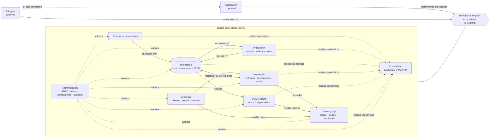

# Quatreros — Resumen del producto

> Etapa A · Descubrimiento documentado · v0.1 · 2026-10-29
> Fuentes: **DM** = `Quatreros_Documento_Maestro_v1.0.pdf` (29-oct-2026). **PM** = Prompt Maestro de arquitectura (instrucciones del responsable del proyecto).
> Convención de estados: `CONFIRMED` · `PROPOSED` · `PENDING` · `BLOCKED`. Todo lo que no proviene del DM o del PM se marca como **[Ampliación Etapa A]**.

---

## 1. Qué es Quatreros

Quatreros es una empresa que **fabrica alimentos** (entre ellos chorizos y rellenas), **los distribuye** con personal propio a restaurantes, negocios y personas naturales, y **opera un punto de venta de asados** (DM §1).

El producto _Quatreros_ es un **sistema a medida, de una sola empresa** (`CONFIRMED`, DM §1, NEG-01), que integra en una única plataforma cloud:

ERP · Compras · Producción · Inventarios · Comercial · Distribución · POS y cocina · Cartera y caja · Contabilidad formal

…más dos **complementos comerciales opcionales e independientes entre sí**: asistente de IA y canal Telegram (`CONFIRMED`, DM §5, §10, §11, IA-01, TG-01).

No es un SaaS multiempresa (`CONFIRMED` como exclusión, DM §2.3).

## 2. Problema que resuelve

Hoy las compras, cantidades y cifras operativas se registran **en cuadernos** (DM §1, §2.1). Esto impide conocer con oportunidad:

- La existencia disponible (materia prima y producto terminado).
- El rendimiento real de fabricación frente al esperado.
- Recaudos, cartera, gastos y rentabilidad.

El objetivo es digitalizar de forma integrada el ciclo completo: **abastecimiento → fabricación para inventario → almacenamiento → venta → entrega → cobro → contabilidad** (DM §1).

## 3. Cómo funciona el negocio (modelo operativo confirmado)

| #   | Hecho operativo                                                                                            | Estado                                            | Fuente                  |
| --- | ---------------------------------------------------------------------------------------------------------- | ------------------------------------------------- | ----------------------- |
| 1   | Se fabrica **para inventario**; compras y producción se disparan por agotamiento de existencias            | CONFIRMED                                         | DM §2.2, NEG-01         |
| 2   | La **cantidad a producir la decide una persona**, apoyada en sugerencias automáticas                       | CONFIRMED                                         | DM §7.1, PRO-02         |
| 3   | Existen **recetas exactas** documentadas                                                                   | CONFIRMED                                         | DM §7.1, PRO-02         |
| 4   | Se vende **por unidad y por paquete**; el paquete tiene cantidad fija y puede abrirse para vender unidades | CONFIRMED (mecánica de movimientos PENDING, P-06) | DM §2.2, PRO-01         |
| 5   | Control de **lote, fabricación, vencimiento y origen de insumos**                                          | CONFIRMED                                         | DM §7.1, INV-01         |
| 6   | Salidas por **FEFO** con excepciones autorizadas                                                           | CONFIRMED                                         | DM §7.1, INV-02         |
| 7   | **Una bodega principal y un POS** al inicio; expansión futura a más puntos                                 | CONFIRMED                                         | DM §2.2, NEG-03         |
| 8   | **Distribuidores propios** con portal web móvil en línea                                                   | CONFIRMED                                         | DM §7.2                 |
| 9   | Pedidos desde **varios canales**, sin integración automática definida                                      | CONFIRMED (integraciones PENDING)                 | DM §2.2                 |
| 10  | Ventas **contraentrega y a crédito**, con cupo y plazo por cliente                                         | CONFIRMED                                         | DM §2.2, CRE-01         |
| 11  | **Precio único** por producto configurable por el administrador                                            | CONFIRMED                                         | DM §7.3, COM-01         |
| 12  | POS vende producto fabricado y **alimentos preparados**, con inventarios funcionalmente separados          | CONFIRMED                                         | DM §7.4                 |
| 13  | **Pagos mixtos**, apertura/cierre por cajero y turno; cierre con diferencia justificada y revisión         | CONFIRMED                                         | DM §7.4, POS-01, POS-02 |
| 14  | **Contabilidad formal completa** dentro de Quatreros, con contador con acceso                              | CONFIRMED (políticas BLOCKED, P-01..P-04)         | DM §9, CTA-01           |

## 4. Componentes del producto

### 4.1 Núcleo obligatorio (debe operar sin IA ni Telegram)

| Módulo                                     | Responsabilidad                                                            | Estado del módulo                                   |
| ------------------------------------------ | -------------------------------------------------------------------------- | --------------------------------------------------- |
| Compras y proveedores                      | Insumos, costos de compra, recepción                                       | Confirmado en alcance                               |
| Producción                                 | Recetas, órdenes, lotes, rendimiento esperado/real, merma                  | Confirmado; costeo BLOCKED (P-03)                   |
| Inventarios                                | MP y terminado, ubicaciones, traslados, presentaciones, trazabilidad, FEFO | Confirmado; paquetes/vencidos PENDING (P-05, P-06)  |
| Comercial (clientes, pedidos, precios)     | Clientes, precio único, pedidos, excepciones                               | Confirmado; descuentos/cancelaciones PENDING (P-09) |
| Distribución                               | Asignación, portal móvil, entregas parciales, devoluciones, recaudo        | Confirmado; liquidación/rutas PENDING (P-08)        |
| POS y cocina                               | Venta inmediata, pagos mixtos, turnos, inventario de cocina                | Confirmado; mermas cocina PENDING (P-07)            |
| Cartera y caja (Finanzas)                  | Cupos, plazos, recaudos, cierres, conciliación                             | Confirmado en alcance                               |
| Contabilidad                               | Libro, asientos, períodos, conciliaciones, reportes                        | Confirmado; **implementación BLOCKED** (P-01..P-04) |
| Administración: usuarios, roles, auditoría | RBAC por sede, aprobaciones configurables, MFA                             | Confirmado; matriz final PENDING (P-10)             |

### 4.2 Complementos opcionales

| Complemento                                                                    | Qué hace                                                                                      | Estado                                                                                 |
| ------------------------------------------------------------------------------ | --------------------------------------------------------------------------------------------- | -------------------------------------------------------------------------------------- |
| Asistente IA (agente **Quatreros AI** sobre Anthropic Managed Agents, DEC-087) | Consultas, alertas, propuestas de registro con resumen + confirmación; demo medible en el MVP | Opcional comercial, CONFIRMED como demo (IA-01, IA-02); precios/límites PENDING (P-14) |
| Telegram                                                                       | Canal remoto: consultas, registros remotos, voz                                               | Contratación independiente CONFIRMED (TG-01); funciones sin IA PENDING (P-13)          |
| Landing page                                                                   | Sitio de presentación                                                                         | PENDING (P-15, LAN-01) — fuera de compromisos                                          |

### 4.3 Fuera del compromiso actual (DM §2.3)

SaaS multiempresa · modo offline (futuro) · predicción avanzada de demanda · landing (no aprobada) · portal de autoservicio para clientes (DM §3).

## 5. Mapa de módulos y flujos

**Lectura del mapa:**

- Inventarios es el **eje**: lo alimentan Compras y Producción y lo consumen Producción, Distribución y POS.
- Finanzas (cartera y caja) concentra **todo el dinero**: recaudos de distribuidores, cierres de caja y crédito de clientes.
- Contabilidad es **consumidora de hechos económicos** de todos los módulos; su tratamiento está bloqueado, pero los módulos operativos pueden emitir eventos trazables desde el inicio **[Ampliación Etapa A, PROPOSED]**.
- IA y Telegram **no tocan la base de datos**: solo invocan los mismos servicios de negocio que usan ERP/POS/Distribución (PM §4.D; DM §10.2 `PROPOSED`).
- Telegram puede funcionar con o sin IA (combinaciones: ninguno / solo IA / solo Telegram / ambos) — PM §4.C.

## 6. Stack confirmado

React + TypeScript + Tailwind (frontend) · Node.js + Express + TypeScript (backend) · PostgreSQL · 100 % cloud con conexión obligatoria (DM §12, TEC-01, TEC-02; PM §3). Monolito modular: `PROPOSED` en DM §12, preferido para evaluación en PM §3. Hosting: `PENDING` (P-12). Presupuesto objetivo < $100.000 COP/mes (TEC-03), cifra deseada, **no viabilidad comprobada**.

## 7. Qué está definido y qué no (diagnóstico corto)

**Definido con suficiente claridad para especificar:** modelo de negocio, módulos y alcance, stack, roles base, lotes/FEFO, crédito con cupo/plazo y autorización por excepción, pagos mixtos y turnos, entregas parciales, devoluciones inspeccionadas, flujo de confirmación de la IA, independencia de IA/Telegram.

**Definido como intención, sin regla operativa:** apertura de paquetes (P-06), vencidos y retiros (P-05), mermas de cocina (P-07), liquidación de reparto (P-08), descuentos/cancelaciones/reembolsos (P-09), matriz de permisos (P-10), funciones de Telegram sin IA (P-13).

**No definido y bloqueante:** todo el tratamiento contable y fiscal (P-01..P-04), incluyendo valoración de inventario y costeo de producción. Esto bloquea la **implementación** de Contabilidad y de los cálculos de costo, pero **no** la especificación ni la construcción de la operación física (cantidades, lotes, movimientos).
