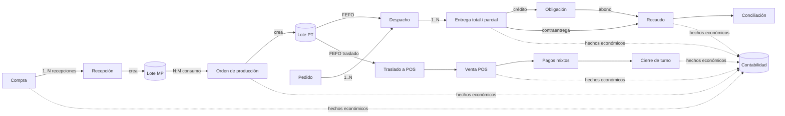
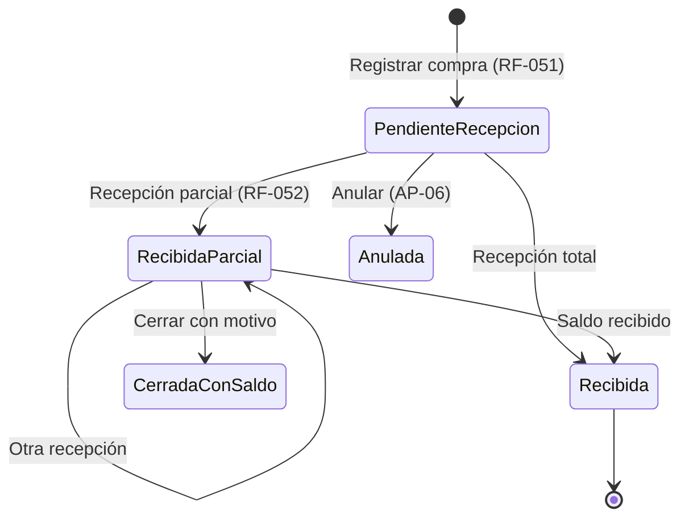
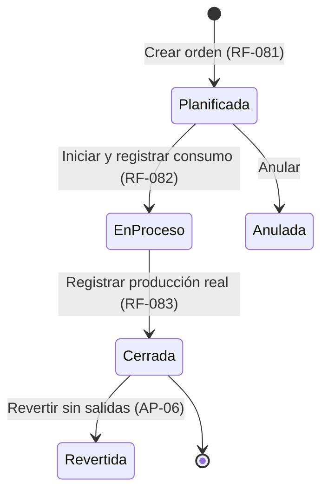
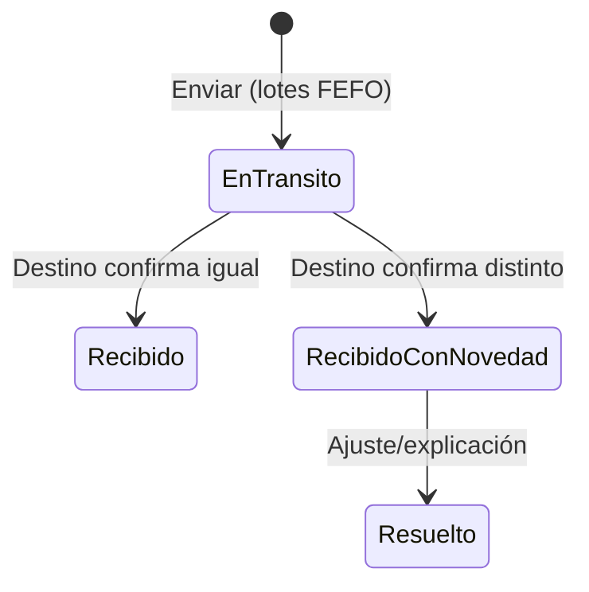
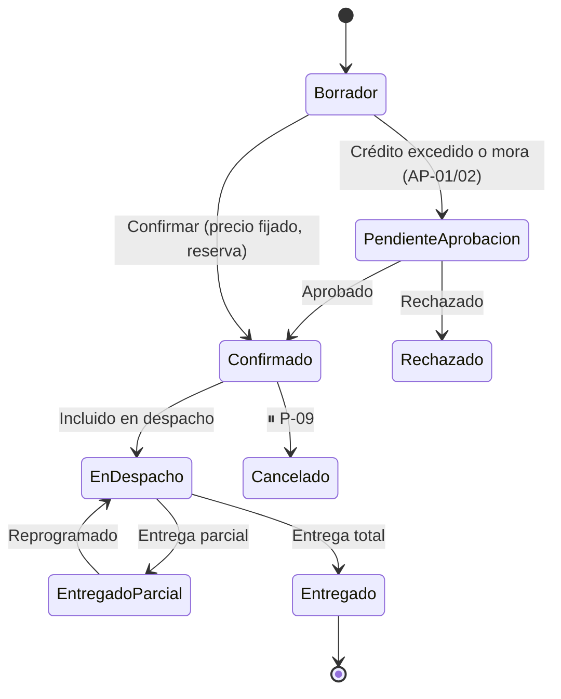
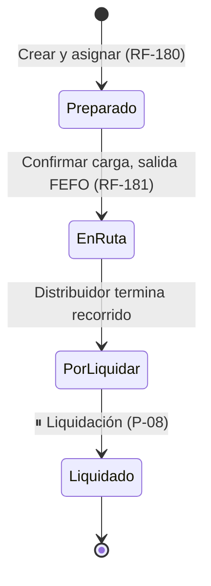
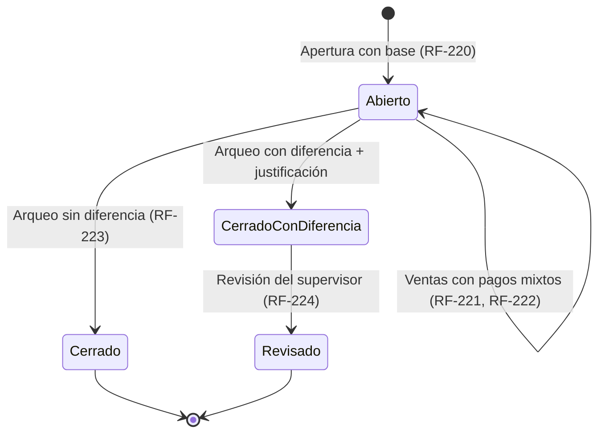
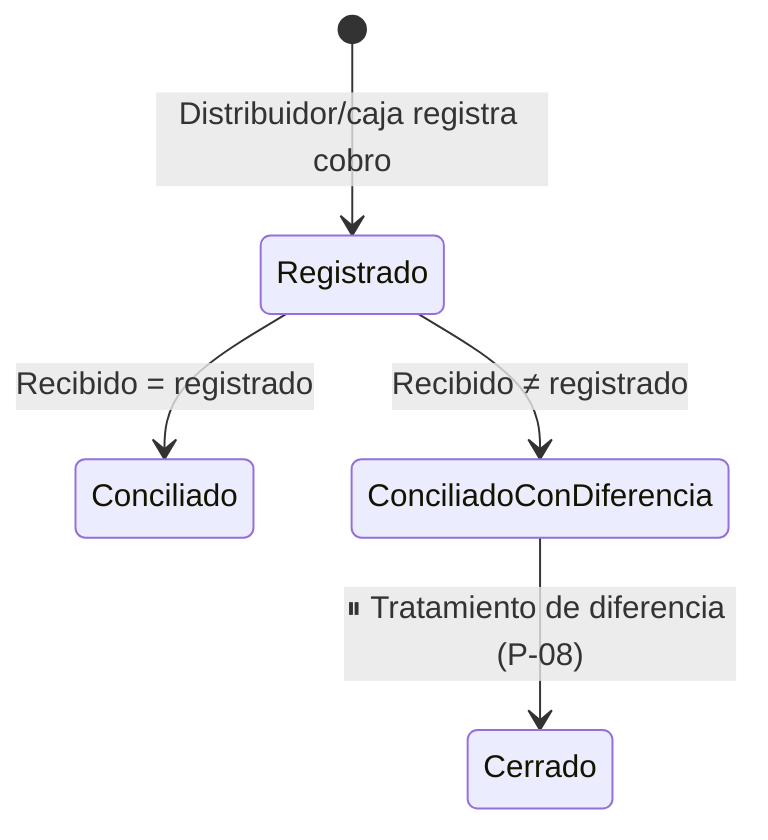
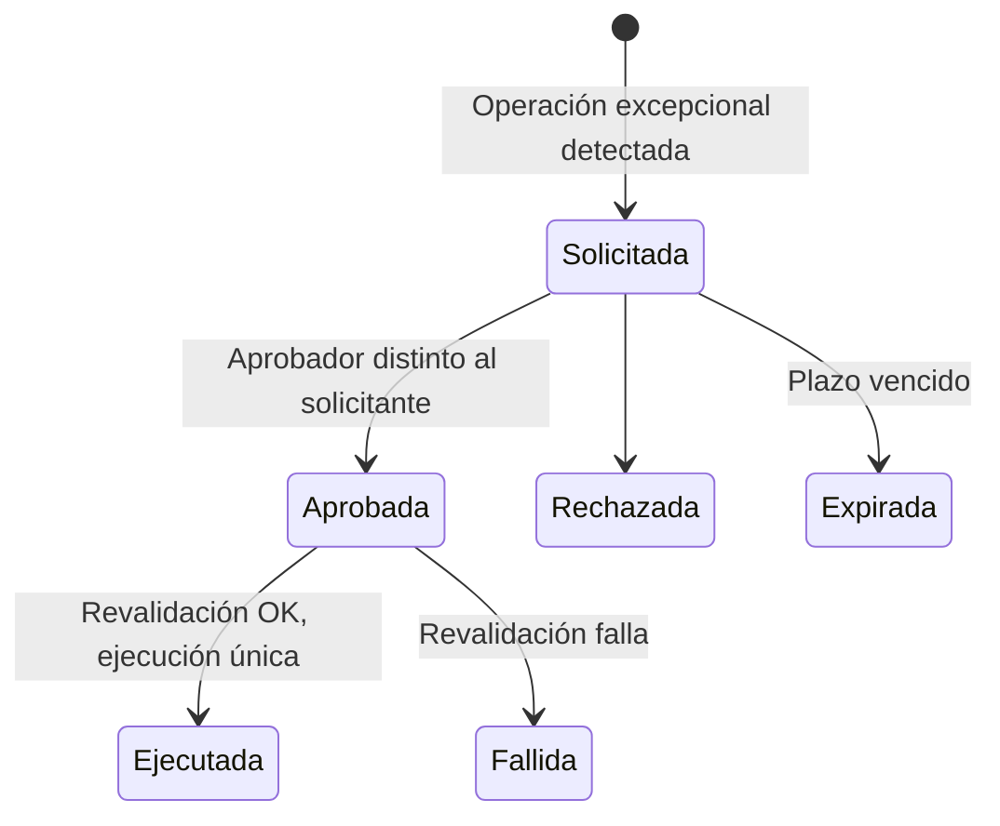
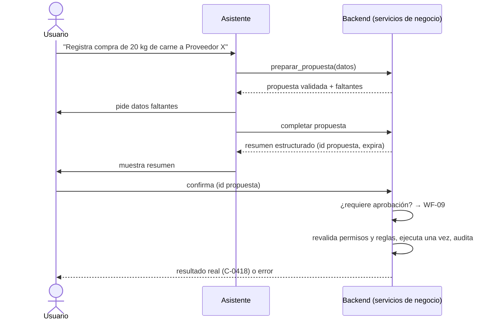

# Flujos de negocio

> Etapa B · v0.1 · 2026-10-29
> Flujos principales con sus estados. Basados en DEC-080 (procesos independientes vinculados). Cada flujo indica los RF y BR que lo implementan. Los pasos `PENDING` se marcan con ⏸.

---

## Vista general: cómo se vinculan los procesos

Una compra no "inicia" una producción ni una venta: cada proceso arranca por su propio disparador y se enlazan por **lotes** y **referencias** (DEC-080).

---

## WF-01 — Compra y recepción de materia prima

**Disparador:** necesidad de reponer MP (sugerencia RF-080 o decisión manual). **RF:** 050–053 · **BR:** 040–044

1. Comprador registra la compra (proveedor, líneas, costo, soporte).
2. Al llegar la mercancía, registra la recepción → crea lote MP y entrada a la ubicación.
3. ⏸ Impuestos de la compra (P-02).
4. Se emite hecho económico `PurchaseReceived` (BR-200).

## WF-02 — Producción para inventario

**Disparador:** decisión humana, apoyada por sugerencias. **RF:** 080–084 · **BR:** 060–068

1. Productor revisa sugerencias y crea orden con receta vigente.
2. Registra consumo real por lote de MP → salidas de MP.
3. Registra producción real → lote PT con fabricación y vencimiento → entrada.
4. Rendimiento fuera de tolerancia → motivo.
5. ⏸ Costo del lote (P-03). Hecho económico `ProductionCompleted` con cantidades y costos de MP capturados.

## WF-03 — Traslado bodega → POS / cocina

**RF:** 114 · **BR:** 083, 088, 089

## WF-04 — Pedido, despacho, entrega y devolución

**Disparador:** pedido del cliente por cualquier canal. **RF:** 150–153, 180–186 · **BR:** 110–128, 171–172

**Estados del pedido:**

**Estados del despacho:**

**En cada visita (portal móvil):**

1. Registrar entrega total o parcial (RF-183). Si es a crédito → obligación (BR-172).
2. Registrar cobro contraentrega o abono (RF-184) → recaudo del distribuidor pendiente de conciliación.
3. Registrar devolución (RF-185) → "en inspección".

**Al regresar:** sobrante reingresa (BR-124); devoluciones se inspeccionan → reincorporar o descartar (AP-08); ⏸ liquidación de mercancía y dinero (P-08); conciliación del recaudo (RF-265).

## WF-05 — Venta en POS y cierre de turno

**RF:** 220–224 · **BR:** 140–150

1. Cajero abre turno.
2. Cada venta: productos fabricados (salida FEFO de la ubicación POS) y preparados (consumo teórico).
3. Pagos mixtos que suman el total.
4. ⏸ Documento fiscal (P-02); ⏸ anulaciones/descuentos (P-09).
5. Cierre con arqueo por método; diferencia → justificación y revisión.

## WF-06 — Control de cocina

**RF:** 225–227 · **BR:** 147–149

1. Conteo inicial de ingredientes de cocina (período ⏸ turno o día).
2. Entradas por traslado (WF-03).
3. Ventas de platos → consumo teórico acumulado.
4. Conteo final.
5. Diferencia por ingrediente = inicial + entradas − final − teórico.
6. ⏸ Clasificación y ajuste (P-07).

## WF-07 — Crédito, cartera y abonos

**RF:** 260–263 · **BR:** 170–174

1. Administrador configura cupo y plazo.
2. Cada venta/pedido a crédito valida cupo y mora → aprobación si excede.
3. La entrega crea la obligación con vencimiento.
4. Abonos (oficina, caja o ruta) se aplican a la obligación más antigua.
5. Cartera vencida bloquea nuevo crédito sin aprobación.

## WF-08 — Recaudo y conciliación

**RF:** 264–265 · **BR:** 175–177

## WF-09 — Aprobación de excepciones

**RF:** 006–007 · **BR:** 003–005

## WF-10 — Escritura asistida por IA (resumen; detalle en Etapa D)

**RF:** 343 · **BR:** 231–234

## WF-11 — Carga inicial y piloto

**RF:** 375–376 · **BR:** 260–261

1. Fecha de corte y responsables.
2. Carga de catálogos (productos, MP, recetas, clientes, proveedores, usuarios).
3. Conteo físico por ubicación, producto, presentación y lote.
4. Carga de saldos (inventario, caja, cartera, CxP) con validación.
5. ⏸ Asiento de apertura con el contador (P-04).
6. Piloto paralelo con comparación diaria; ⏸ criterio de salida (P-16).
