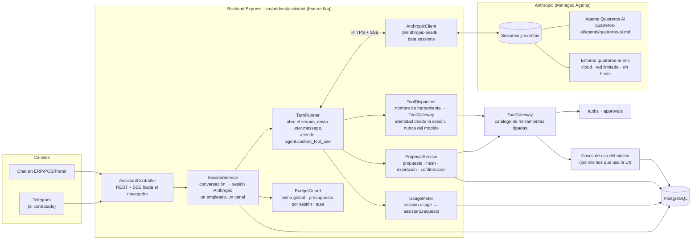
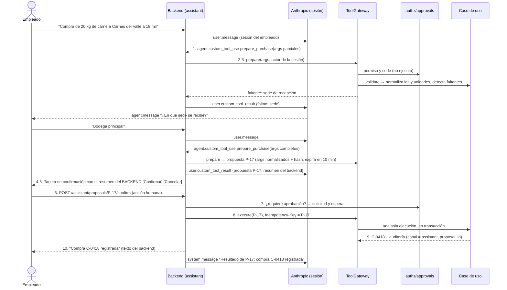
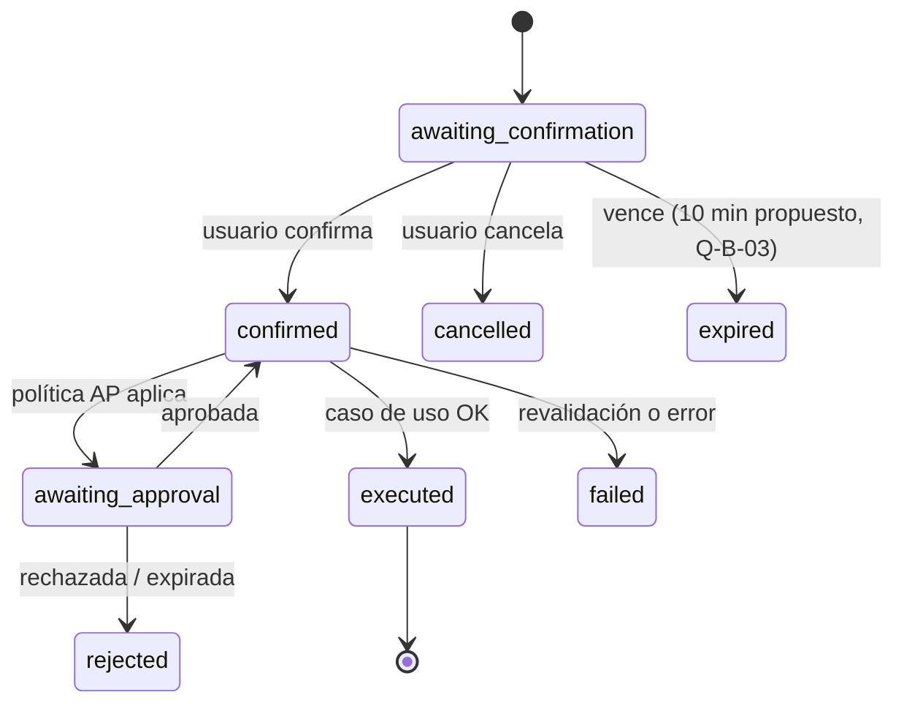

# Arquitectura del asistente de IA (Quatreros AI)

> Etapa C/D · v0.2 · 2026-10-30. Cambio frente a la v0.1: el asistente es el agente **Quatreros AI** sobre **Anthropic Managed Agents** (DEC-087, ADR-023), con su configuración versionada en `quatreros-ai/`.
> Complemento **opcional**: demostración funcional y medible en el MVP, contratación posterior (DEC-070). El ERP funciona igual con el asistente apagado (DEC-071).
> Principio rector: **el modelo propone, el backend valida, el humano confirma, el backend ejecuta y responde con el resultado real.**
> **Estado:** diseño. No hay código del asistente en el backend y el agente no tiene herramientas declaradas (§14). Que la configuración esté en el repositorio **no** significa que la IA esté integrada.

---

## 1. Componentes

- **ToolGateway** sigue siendo la única puerta al núcleo (ADR-015). Cada herramienta envuelve un **caso de uso existente** con su contrato Zod; el asistente no duplica servicios del negocio.
- **El agente no ejecuta nada en el ERP.** Sus herramientas son de tipo `custom`: Claude emite una solicitud estructurada, el backend la ejecuta y devuelve el resultado a la sesión.
- **Sin acceso directo a datos.** El entorno del agente tiene red `limited` sin hosts permitidos y el conjunto de herramientas integrado (bash, archivos, web) está apagado (`default_config.enabled: false`). El agente no tiene credenciales de base de datos ni del backend (RNF-009, DEC-P05/P06).

### 1.1 Responsabilidades

| Componente                       | Hace                                                                                                                                                                                         | No hace                                                                                   |
| -------------------------------- | -------------------------------------------------------------------------------------------------------------------------------------------------------------------------------------------- | ----------------------------------------------------------------------------------------- |
| **Backend Express**              | Autenticación, autorización (RBAC + sede + canal), validaciones del negocio, propuestas y confirmaciones, ejecución transaccional, auditoría, integración con Anthropic, medición de consumo | Delegar decisiones de permisos al modelo                                                  |
| **Quatreros AI** (Managed Agent) | Interpretar solicitudes, pedir herramientas, preparar operaciones, resumir, recomendar, conversar en español colombiano                                                                      | Ejecutar escrituras, ver datos sin herramienta, afirmar éxitos que no devolvió el backend |
| **PostgreSQL**                   | Datos y movimientos del negocio, propuestas y su estado, autorizaciones, vínculo conversación ↔ sesión, auditoría y métricas de consumo                                                      | —                                                                                         |
| **Anthropic**                    | Sesiones, historial de la conversación (transcripción), ejecución del modelo                                                                                                                 | Ser fuente de verdad del negocio (DEC-088)                                                |

### 1.2 Conceptos de Managed Agents en Quatreros

| Managed Agents     | En Quatreros                                                                                                                                                                                                      | Fuente                                                        |
| ------------------ | ----------------------------------------------------------------------------------------------------------------------------------------------------------------------------------------------------------------- | ------------------------------------------------------------- |
| Agente (`agent_…`) | Quatreros AI: modelo, prompt del sistema, herramientas `custom`                                                                                                                                                   | `quatreros-ai/agents/quatreros-ai.md`                         |
| Entorno (`env_…`)  | Contenedor `cloud` sin red útil; solo aloja la sesión                                                                                                                                                             | `quatreros-ai/environments/quatreros-ai-env.yml`              |
| Sesión (`sesn_…`)  | Una conversación de **un** empleado por **un** canal                                                                                                                                                              | `assistant.conversations`                                     |
| Eventos            | `user.message` / `system.message` (backend → agente), `agent.message`, `agent.custom_tool_use` (agente → backend), `user.custom_tool_result` (respuesta), `session.status_idle`, `session.usage`, `session.error` | API de eventos (`/v1/sessions/{id}/events`, `/events/stream`) |
| `claude-lock.json` | IDs de agente y entorno ligados a los archivos; `ant apply` lo mantiene                                                                                                                                           | `quatreros-ai/claude-lock.json`                               |

## 2. Catálogo de herramientas

Cada herramienta se declara en el agente como `type: custom` con `name`, `description` (tres o cuatro frases: qué hace, cuándo usarla y cuándo no, parámetros, salvedades) e `input_schema` (JSON Schema). Los archivos van en `quatreros-ai/agents/tools/<herramienta>.json` y el agente los incluye con una ruta en `tools` (`ant apply` inserta su contenido). Los nombres usan `snake_case` (no se admiten puntos ni los prefijos `mcp__` y `ant__`). El esquema de entrada **nunca** incluye usuario, rol ni sede: esos datos los pone el backend.

> **Regla de despliegue:** una herramienta se agrega al agente **después** de que el backend tenga su manejador desplegado (§11). Una herramienta declarada sin manejador deja la sesión esperando (`requires_action`).

### 2.1 Lectura (habilitables al aprobar la demo; respetan permisos y sede)

| Herramienta (`custom`)            | Caso de uso                              | Permiso                         | Disponible desde |
| --------------------------------- | ---------------------------------------- | ------------------------------- | ---------------- |
| `inventory_get_availability`      | Existencias disponibles por presentación | `inv.stock.read`                | Entrega 2        |
| `inventory_get_expiring_lots`     | Lotes por vencer                         | `inv.stock.read`                | Entrega 2        |
| `inventory_trace_lot`             | Trazabilidad                             | `inv.traceability.read`         | Entrega 2        |
| `catalog_search_products`         | Resolver nombres → ids                   | `cat.product.read`              | Entrega 2        |
| `sales_list_open_orders`          | Pedidos pendientes                       | `com.order.*` lectura           | Entrega 5        |
| `sales_search_customers`          | Resolver clientes                        | `com.customer.read`             | Entrega 5        |
| `finance_get_customer_balance`    | Saldo, cupo disponible, mora             | `fin.receivable.read`           | Entrega 7        |
| `finance_get_overdue_receivables` | Cartera vencida                          | `fin.receivable.read`           | Entrega 7        |
| `production_get_suggestions`      | Sugerencias de producción                | `prod.suggestion.read`          | Entrega 4        |
| `production_get_yield_report`     | Rendimiento real vs. esperado            | `rep.operational.read`          | Entrega 4        |
| `pos_get_shift_summary`           | Ventas del turno                         | `pos.sale.create@OWN` o ADM/MGR | Entrega 6        |
| `reports_sales_summary`           | Ventas por período                       | `rep.operational.read`          | Entrega 7        |

No se implementa ninguna herramienta cuyo módulo no exista todavía.

### 2.2 Escritura: solo **preparación** (deshabilitadas hasta aprobar la matriz de permisos, BR-234; lista blanca en Q-C-05 / Q-IA-03)

El agente solo recibe herramientas `prepare_*`. Estas validan y crean una **propuesta**; **no existe una herramienta de ejecución**. La ejecución ocurre cuando el empleado confirma en la interfaz (§3).

| Herramienta (`custom`)                                         | Caso de uso | Riesgo                       | Propuesta                  |
| -------------------------------------------------------------- | ----------- | ---------------------------- | -------------------------- |
| `prepare_purchase`                                             | RF-051      | Medio                        | Incluir en demo            |
| `prepare_sales_order`                                          | RF-151      | Medio (crédito → aprobación) | Incluir en demo            |
| `prepare_transfer`                                             | RF-114      | Medio                        | Incluir                    |
| `prepare_production_order`                                     | RF-081      | Bajo                         | Incluir                    |
| `prepare_payment`                                              | RF-263      | Alto (dinero)                | Excluir de la demo inicial |
| Precios, permisos, crédito, ajustes, anulaciones, contabilidad | —           | Alto                         | **Excluidas**              |

## 3. Flujo de escritura (10 pasos obligatorios, DEC-072/074, PM §9)

**Reglas clave:**

- **Confirmar es una acción de la interfaz:** un botón en la web o un comando explícito en Telegram. Nunca es una herramienta que el modelo pueda llamar. La confirmación queda **persistida** en `assistant.proposals` y vinculada a la propuesta exacta (hash de argumentos normalizados).
- El resumen de la tarjeta se genera **desde los argumentos normalizados del backend**, no desde el texto del modelo. Incluye unidades y presentaciones explícitas (R-IA-07).
- El resultado lo informa el backend con el `result_ref` del caso de uso. Después se avisa a la sesión con un `system.message`, para que la conversación siga coherente (BR-233, R-IA-01).
- El prompt actual del agente ya exige que no se ejecute nada sin una confirmación verificada por el backend. Este diseño lo cumple sin herramienta de ejecución.

## 4. Estados de una propuesta

## 5. Idempotencia y concurrencia

- `proposal.id` se usa como `Idempotency-Key` de la ejecución. Confirmar dos veces, los reintentos de red o el doble clic producen **una sola** operación (BR-232).
- La transición `awaiting_confirmation → confirmed` es `UPDATE … WHERE status = 'awaiting_confirmation' RETURNING`, así que solo una confirmación gana.
- Cada `agent.custom_tool_use` se registra por su `id` (único en `assistant.tool_calls`). Si el backend recibe el mismo evento dos veces (por ejemplo, al reconectar el stream), no vuelve a ejecutar; Anthropic ignora un segundo resultado para la misma llamada.
- **Un turno a la vez por conversación.** Mientras la sesión está `running`, un mensaje nuevo del empleado se rechaza con 409 ("espera la respuesta"), salvo que pida **detener**. En ese caso se envía `user.interrupt`.
- Si los datos de referencia cambian entre la propuesta y la ejecución (precio, existencias, cupo), decide la revalidación del caso de uso y la propuesta pasa a `failed` con el motivo.

## 6. Sesiones, identidad y aislamiento entre empleados

| Tema                      | Diseño                                                                                                                                                                                                                                                                                |
| ------------------------- | ------------------------------------------------------------------------------------------------------------------------------------------------------------------------------------------------------------------------------------------------------------------------------------- |
| Alcance de una sesión     | **Una sesión de Anthropic por conversación**, con **un solo empleado** y **un solo canal**. Nunca se comparte entre empleados: el historial de uno no puede aparecer en la conversación de otro                                                                                       |
| Vínculo                   | `assistant.conversations` guarda `user_id`, `channel`, `anthropic_session_id`, la versión del agente usada, el estado y la última actividad                                                                                                                                           |
| Identidad en herramientas | El `ToolDispatcher` obtiene el actor desde `anthropic_session_id → conversation → user_id` y **lo recarga en cada llamada** (`loadActor`). Así, una desactivación o un cambio de permisos aplica de inmediato. Nada que el modelo escriba puede cambiar el usuario, el rol ni la sede |
| Contexto inicial          | Al crear la sesión, un `system.message` con la fecha en America/Bogota, el nombre visible, los roles y las sedes del empleado. Es solo informativo: los permisos se aplican en el servidor                                                                                            |
| Metadatos en Anthropic    | `metadata` de la sesión (máximo 16 claves) con referencias internas no personales: `app`, `env`, `conversation_id`, `user_ref` (UUID interno). Sin correos ni nombres                                                                                                                 |
| Persistencia              | Anthropic guarda el historial de eventos hasta que se borra la sesión. Propuesto (Q-IA-05): **archivar** tras 24 h sin actividad y **borrar** a los 30 días. Las métricas propias (`assistant.requests`) se conservan                                                                 |
| Usuario desactivado       | Sus conversaciones se cierran, las propuestas abiertas pasan a `cancelled` y sus sesiones se archivan                                                                                                                                                                                 |
| Memoria del agente        | No se usan memory stores para datos del negocio (DEC-088). Cualquier dato operativo se consulta de nuevo con una herramienta                                                                                                                                                          |

## 7. Consumo, costos y protección

**Medición (RF-344, BR-236, DEC-P12).** Anthropic informa el consumo acumulado de cada sesión en el evento `session.usage`, que se emite antes de cada paso a `idle`, y en el campo `usage` de la sesión. Ese consumo incluye:

- `input_tokens`, `output_tokens`, `cache_read_input_tokens` y `cache_creation`;
- `list_cost`: centavos de USD a precio de lista, en texto;
- `active_seconds`: el tiempo de ejecución, que **también se cobra**.

El `UsageMeter` guarda en `assistant.requests` la diferencia de cada turno, junto con la conversación, el usuario, el canal, las herramientas usadas, la operación, la duración y el resultado. El tablero agrega por modelo, usuario, operación y período, y separa el costo base del núcleo del incremental (DEC-082). En la consola de Anthropic, el consumo también se puede agrupar por agente.

| Mecanismo                                                          | Valor propuesto                                                                                     | Estado                     |
| ------------------------------------------------------------------ | --------------------------------------------------------------------------------------------------- | -------------------------- |
| Techo global mensual (USD), con pausa automática del complemento   | USD 10/mes durante la demo                                                                          | PROPOSED (Q-C-06, DEC-P11) |
| Presupuesto por sesión (`budget.max_list_cost`, fijado al crearla) | USD 0,50 por conversación                                                                           | PROPOSED                   |
| Alertas al Administrador                                           | 80 % y 100 % del techo                                                                              | PROPOSED (RF-345)          |
| Máximo de llamadas a herramientas por turno                        | 6; desde la séptima, el backend responde `is_error` y envía `user.interrupt`                        | PROPOSED                   |
| Tiempo límite por turno                                            | 60 s; luego `user.interrupt` y mensaje al empleado                                                  | PROPOSED (RNF-131)         |
| Límite de tasa por usuario (protección, no cuota comercial)        | 30 mensajes / 10 min                                                                                | PROPOSED (DEC-075)         |
| Caché de herramientas de lectura                                   | 30 s por usuario y argumentos                                                                       | PROPOSED                   |
| Límites de la plataforma                                           | 300 creaciones/min y 1.200 lecturas/min por organización, más el límite de gasto de la organización | Anthropic                  |

Con `budget_reached`, la sesión queda en pausa y el empleado recibe un aviso para iniciar otra conversación. Si se alcanza el techo global, el complemento se pausa para todos.

## 8. Manejo de errores

| Situación                                    | Comportamiento                                                                                                                                                                                                              |
| -------------------------------------------- | --------------------------------------------------------------------------------------------------------------------------------------------------------------------------------------------------------------------------- |
| Anthropic caído o tiempo agotado             | "El asistente no está disponible; puedes hacerlo desde el menú X", con enlace a la pantalla. El núcleo no se ve afectado                                                                                                    |
| `session.error` / estado `rescheduling`      | `rescheduling` es un reintento de la plataforma: se espera. Un error irrecuperable deja la sesión `terminated`; se abre una sesión nueva y se avisa al empleado                                                             |
| El backend se reinicia a mitad de un turno   | Al reanudar, se listan los eventos de la sesión (`events.list`) y se responden las llamadas pendientes de `stop_reason.event_ids`. Las de lectura se ejecutan; las `prepare_*` se reconstruyen desde `assistant.tool_calls` |
| Herramienta declarada sin manejador          | Se responde `is_error: true` con "herramienta no disponible". Nunca se deja la sesión esperando                                                                                                                             |
| Herramienta devuelve 403 o 404               | Resultado `is_error` tipado; el modelo explica que no hay acceso y no reintenta con otros ids                                                                                                                               |
| Validación del negocio (409)                 | Mensaje del backend; si requiere aprobación, se ofrece solicitarla                                                                                                                                                          |
| El modelo inventa un id o argumento inválido | `prepare` lo rechaza (Zod más existencia) y se pide aclaración                                                                                                                                                              |
| Ambigüedad ("10 de chorizo")                 | El backend devuelve candidatos (unidad o paquete) y el asistente pregunta                                                                                                                                                   |
| `budget_reached` / techo global              | Aviso claro; el Administrador recibe notificación al llegar al techo                                                                                                                                                        |

## 9. Seguridad del asistente

- **Clave de API solo en el servidor** (`ANTHROPIC_API_KEY`). El navegador y Telegram hablan con el backend, nunca con Anthropic.
- **Inyección de instrucciones:**
  - Los resultados de herramientas se marcan como datos.
  - Las herramientas solo aceptan parámetros tipados y nunca la identidad.
  - Las escrituras exigen confirmación humana y revalidación.
  - Por eso, una instrucción maliciosa dentro de un nombre de cliente no puede ejecutar nada por sí sola (R-IA-04).
- **Mínimo dato:** las herramientas devuelven solo los campos necesarios, filtrados por permisos y sede antes de salir hacia Anthropic (RNF-022). Los identificadores personales se pueden enmascarar.
- **Salida del modelo:** se muestra como texto plano en la interfaz, sin HTML ni enlaces activos que no sean del backend.
- **Auditoría:** toda ejecución queda con `channel = assistant`, `proposal_id` y `anthropic_session_id` (BR-005).
- **Retención:** Managed Agents no es elegible para Zero Data Retention. Lo que pasa por la sesión queda en Anthropic hasta que se borra la sesión (§6, Q-IA-05).
- **Prompt del sistema** versionado en `quatreros-ai/agents/quatreros-ai.md`, con revisión por PR y pruebas de regresión (§13).

## 10. Activación y desactivación

- La activación efectiva está en `platform.addon_settings('assistant').is_enabled` (RF-340). Solo se puede activar si el backend tiene configuradas las variables de §12.
- Con el asistente apagado:
  - las rutas `/assistant/*` responden 404;
  - el widget de chat no se carga;
  - las propuestas abiertas pasan a `cancelled`;
  - no se crean sesiones en Anthropic.
- `feature.assistant.writes` controla aparte las herramientas `prepare_*`. Está apagada hasta Q-B-01.
- Telegram se activa por separado (DEC-076). Con Telegram encendido y el asistente apagado, los mensajes libres reciben "el asistente no está contratado" y los comandos fijos siguen funcionando.

## 11. El agente como código (`ant`)

La configuración del agente se trata como código, pero **no se despliega con el backend**:

| Paso              | Qué se hace                                                                                                                       | Quién                                           |
| ----------------- | --------------------------------------------------------------------------------------------------------------------------------- | ----------------------------------------------- |
| 1. Cambio local   | Editar `quatreros-ai/agents/*.md`, `agents/tools/*.json` o `environments/*.yml`                                                   | Desarrollador o agente                          |
| 2. Revisión       | PR en GitHub. El cambio de comportamiento se justifica en el PR y, si toca reglas, se cita su `DEC-###`                           | Responsable                                     |
| 3. Plan           | `cd quatreros-ai && ant apply --dry-run .` muestra el plan sin cambiar nada                                                       | Quien tenga credenciales del espacio de trabajo |
| 4. Sincronización | `cd quatreros-ai && ant apply .` y aprobar el plan. Luego se hace commit del `claude-lock.json` actualizado                       | **Solo con autorización del responsable**       |
| 5. Verificación   | Probar en Anthropic Console y en el entorno de desarrollo del backend                                                             | Responsable / QA                                |
| 6. Producción     | Espacio de trabajo propio con su propio lockfile (`ant apply --lock-file claude-lock.production.json .`) y publicación controlada | Pendiente (Q-IA-04)                             |

- `git push` **no** actualiza el agente en Anthropic, y `ant apply` **no** despliega el backend Express. Son dos publicaciones distintas.
- **Orden al agregar una herramienta:** primero se despliega el backend con su manejador (detrás del flag), después se ejecuta `ant apply`. **Al quitarla:** primero `ant apply`, después el backend.
- **Primera sincronización:** el `claude-lock.json` exportado ya trae los IDs (`agent_01GV2…`, `env_01BMh…`) con `hash` vacío y sin bloque `origin`. El primer `ant apply` **adopta** esos recursos con una actualización cada uno y los marca como gestionados por `ant`. Debe hacerse con credenciales de la **misma organización y espacio de trabajo** donde se creó el agente. Desde ese momento, `ant` rechaza credenciales de otro espacio.
- Después de adoptarlo, **no se edita el agente en la consola**. Un cambio hecho por fuera bloquea el plan (`refusing to apply`), y `--force` lo sobrescribiría. `--prune` y `--force` requieren revisión explícita.
- El lockfile se versiona y no se edita a mano. No contiene secretos: solo IDs y huellas. Nunca se ejecutan dos `ant apply` a la vez.
- **Posible automatización** (requiere aprobación, Q-IA-04): `ant apply --dry-run .` en los PR que toquen `quatreros-ai/`, con Workload Identity Federation en lugar de una clave guardada.

## 12. Configuración

| Variable                         | Uso                                                                             | Secreto                                             | Origen del valor                                                        |
| -------------------------------- | ------------------------------------------------------------------------------- | --------------------------------------------------- | ----------------------------------------------------------------------- |
| `ANTHROPIC_API_KEY`              | Llamadas del backend a Anthropic                                                | **Sí**; solo en el servidor o el gestor del hosting | Consola de Anthropic, espacio de trabajo del entorno                    |
| `ANTHROPIC_AGENT_ID`             | Agente que usan las sesiones                                                    | No (pero depende del entorno)                       | `quatreros-ai/claude-lock.json` → `./agents/quatreros-ai.md`            |
| `ANTHROPIC_AGENT_VERSION`        | Fija la versión del agente (vacío = la más reciente). Recomendado en producción | No                                                  | Lockfile (`version`)                                                    |
| `ANTHROPIC_ENVIRONMENT_ID`       | Entorno de las sesiones                                                         | No (depende del entorno)                            | `quatreros-ai/claude-lock.json` → `./environments/quatreros-ai-env.yml` |
| `ASSISTANT_SESSION_BUDGET_CENTS` | `budget.max_list_cost` de cada sesión nueva                                     | No                                                  | §7 (PROPOSED)                                                           |

Los nombres se ajustan al SDK oficial (`@anthropic-ai/sdk`, que lee `ANTHROPIC_API_KEY`). La activación sigue en la base de datos (§10), no en variables. Desarrollo y producción usan **claves e IDs distintos**.

## 13. Modelo y evaluación

- La configuración actual usa `claude-haiku-5-5` con `effort: low`, una opción de bajo costo. Antes de la demo se confirma con la evaluación (Q-IA-06):
  1. Un conjunto fijo de 20 a 30 casos (Q-IA-01): consultas, ambigüedades, preparación de escrituras, intentos sin permiso e inyección.
  2. Se mide la exactitud de herramientas y argumentos, la latencia p95 y el **costo por conversación** (`list_cost`, que incluye tiempo de ejecución).
  3. Si no alcanza el umbral, se compara con otro modelo de Anthropic **cambiando solo el campo `model`** del agente, mediante PR y `ant apply`.
- La evaluación se repite como prueba de regresión cada vez que cambian el modelo, el prompt o las herramientas.

## 14. Estado de implementación (2026-10-30)

| Pieza                                      | Estado                                                                                                                      |
| ------------------------------------------ | --------------------------------------------------------------------------------------------------------------------------- |
| Agente y entorno en Anthropic              | Creados en la consola y exportados a `quatreros-ai/`. Aún no adoptados por `ant` (hash vacío)                               |
| Herramientas `custom` del agente           | **Ninguna.** Hoy el agente solo puede conversar                                                                             |
| Módulo `src/addons/assistant` del backend  | No implementado (solo existe la carpeta `addons/` con sus reglas de fronteras)                                              |
| `ToolGateway`                              | No implementado                                                                                                             |
| Esquema `assistant` en PostgreSQL          | Diseñado (database-design), sin migración                                                                                   |
| Pantalla de chat y tarjeta de confirmación | No implementadas                                                                                                            |
| **Integración funcional**                  | **No.** Se considerará completa cuando existan herramientas conectadas, controles de seguridad y pruebas verificables (§15) |

## 15. Dependencias para operar de verdad

En orden: la entrega 8 del roadmap, y algunas lecturas desde que exista su módulo.

1. Esquema `assistant` (`conversations`, `tool_calls`, `proposals`, `requests`) con su migración y permisos.
2. `AnthropicClient`: SDK, tiempos límite, reintentos solo en errores transitorios y reconexión del stream sin huecos (`events.list` + `stream`, descartando ids ya vistos).
3. `SessionService` + `TurnRunner` + rutas `/assistant/*` con SSE hacia el navegador y un turno a la vez.
4. `ToolGateway` y `ToolDispatcher`, con identidad desde la sesión, permisos y sede, y auditoría por canal.
5. Las primeras herramientas de lectura **de módulos ya construidos** (desde la entrega 2: inventario y catálogo) y su declaración en `quatreros-ai/agents/tools/`.
6. `ProposalService`, el endpoint de confirmación y la tarjeta de confirmación en la interfaz (sistema de diseño, Parte 2 §5).
7. `UsageMeter`, `BudgetGuard` y el tablero de consumo.
8. Pruebas:
   - unitarias de despacho e identidad;
   - integración con un cliente de Anthropic simulado (eventos grabados);
   - E2E de la tarjeta de confirmación;
   - evaluación del modelo (§13).

## 16. Pendientes

| Tema                                                                                  | Ref.                         |
| ------------------------------------------------------------------------------------- | ---------------------------- |
| Casos de uso de la demo                                                               | Q-IA-01                      |
| Techo de costo y modelo comercial                                                     | Q-IA-02, Q-C-06, P-14        |
| Lista blanca de escrituras                                                            | Q-C-05, Q-IA-03              |
| Expiración de confirmaciones                                                          | Q-B-03 (provisional: 10 min) |
| Espacios de trabajo y lockfiles de desarrollo y producción; quién ejecuta `ant apply` | Q-IA-04                      |
| Retención de sesiones en Anthropic                                                    | Q-IA-05                      |
| Confirmación del modelo tras la evaluación                                            | Q-IA-06                      |
| Habilitar escrituras                                                                  | Q-B-01 (matriz de permisos)  |
