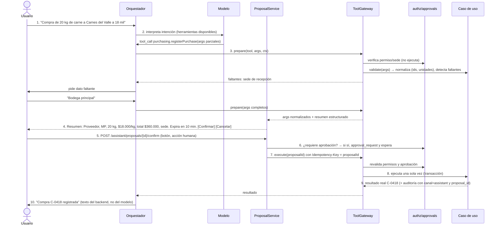
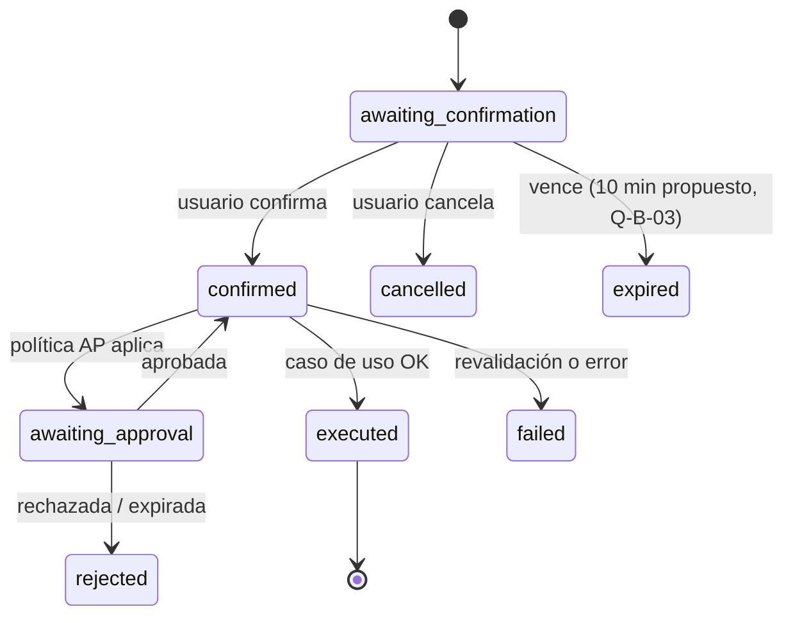

# Arquitectura del asistente de IA

> Etapa C/D · v0.1 · 2026-10-29
> Complemento **opcional**: demostración funcional en el MVP, contratación posterior (DEC-070). El ERP funciona igual con el asistente apagado (DEC-071).
> Principio rector: **el modelo propone, el backend valida, el humano confirma, el backend ejecuta y responde con el resultado real.**

---

## 1. Componentes

```mermaid
flowchart LR
  subgraph Canales
    W[Chat en ERP/POS/Portal]
    T[Telegram\n(si contratado)]
  end
  subgraph assistant["Módulo assistant (feature flag)"]
    ORQ[Orquestador\nbucle de herramientas con límites]
    PRV[ProviderAdapter\nAI SDK · modelo configurable]
    BUD[BudgetGuard\ntecho global · iteraciones · tasa]
    MET[UsageMeter\ntokens · costo · herramienta]
    PROP[ProposalService\npropuesta · hash · expiración · confirmación]
  end
  GW[ToolGateway\ncatálogo de herramientas tipadas]
  UC[Casos de uso del núcleo\n(los mismos que usa la UI)]
  AUTHZ[authz + approvals]
  W & T --> ORQ
  ORQ --> BUD --> PRV --> LLM[(Proveedor IA)]
  ORQ --> GW
  GW --> AUTHZ
  GW --> UC
  ORQ --> PROP
  PROP --> GW
  ORQ --> MET
```

- **ToolGateway** es la única puerta al núcleo. Cada herramienta envuelve un **caso de uso existente** con su contrato Zod; no hay lógica de negocio en el asistente (PM §4.D).
- El asistente **no tiene credenciales de BD** (PM §9; RNF-009).
- `ProviderAdapter` usa AI SDK con proveedores intercambiables (ADR-016, PROPOSED).

## 2. Catálogo de herramientas

### 2.1 Lectura (habilitables al aprobar la demo; respetan permisos y sede)

| Herramienta                                      | Caso de uso                              | Permiso                         |
| ------------------------------------------------ | ---------------------------------------- | ------------------------------- |
| `inventory.getAvailability(product?, location?)` | Existencias disponibles por presentación | `inv.stock.read`                |
| `inventory.getExpiringLots(days)`                | Lotes por vencer                         | `inv.stock.read`                |
| `inventory.traceLot(lotCode)`                    | Trazabilidad                             | `inv.traceability.read`         |
| `sales.listOpenOrders(customer?)`                | Pedidos pendientes                       | `com.order.*` lectura           |
| `finance.getCustomerBalance(customer)`           | Saldo, cupo disponible, mora             | `fin.receivable.read`           |
| `finance.getOverdueReceivables()`                | Cartera vencida                          | `fin.receivable.read`           |
| `production.getSuggestions()`                    | Sugerencias de producción                | `prod.suggestion.read`          |
| `production.getYieldReport(period)`              | Rendimiento real vs. esperado            | `rep.operational.read`          |
| `pos.getShiftSummary(shift?)`                    | Ventas del turno                         | `pos.sale.create@OWN` o ADM/MGR |
| `reports.salesSummary(period, site?)`            | Ventas por período                       | `rep.operational.read`          |
| `catalog.searchProducts(text)`                   | Resolver nombres → ids                   | `cat.product.read`              |
| `sales.searchCustomers(text)`                    | Resolver clientes                        | `com.customer.read`             |

### 2.2 Escritura (**deshabilitadas** hasta aprobar la matriz de permisos — BR-234; lista blanca propuesta para Q-IA-03)

| Herramienta                                                              | Caso de uso | Riesgo                       | Propuesta                  |
| ------------------------------------------------------------------------ | ----------- | ---------------------------- | -------------------------- |
| `purchasing.registerPurchase`                                            | RF-051      | Medio                        | Incluir en demo            |
| `sales.createOrder`                                                      | RF-151      | Medio (crédito → aprobación) | Incluir en demo            |
| `inventory.createTransfer`                                               | RF-114      | Medio                        | Incluir                    |
| `production.createOrder`                                                 | RF-081      | Bajo                         | Incluir                    |
| `finance.registerPayment`                                                | RF-263      | Alto (dinero)                | Excluir de la demo inicial |
| Cambios de precio, permisos, crédito, ajustes, anulaciones, contabilidad | —           | Alto                         | **Excluidas**              |

## 3. Flujo de escritura (10 pasos obligatorios, PM §9)



**Reglas clave:**

- La **confirmación es una acción de la interfaz** (botón o comando explícito "/confirmar <código>" en Telegram), nunca una herramienta que el modelo pueda llamar.
- El resumen se genera **desde los argumentos normalizados del backend**, no desde el texto del modelo; incluye unidades y presentaciones explícitas (R-IA-07).
- `arguments_hash` se calcula sobre los argumentos normalizados; confirmar ejecuta exactamente eso.
- El modelo **nunca** informa éxito por su cuenta: el mensaje final se arma con el `result_ref` devuelto por el caso de uso (BR-233).

## 4. Estados de una propuesta



## 5. Idempotencia y concurrencia

- `proposal.id` se usa como `Idempotency-Key` de la ejecución: confirmar dos veces, reintentos de red o doble clic producen **una sola** operación (BR-232).
- La transición `awaiting_confirmation → confirmed` se hace con `UPDATE … WHERE status = 'awaiting_confirmation' RETURNING` (solo una confirmación gana).
- Si los datos de referencia cambian entre propuesta y ejecución (precio, existencias, cupo), la revalidación del caso de uso decide; la propuesta pasa a `failed` con el motivo.

## 6. Control de costos y protección

| Mecanismo                                                   | Valor propuesto                                           | Estado                                      |
| ----------------------------------------------------------- | --------------------------------------------------------- | ------------------------------------------- |
| Techo global mensual (USD) con pausa automática             | Definir en Q-IA-02 (p. ej. USD 10 en demo)                | PROPOSED (DEC-P11)                          |
| Alertas al Administrador                                    | 80 % y 100 % del techo                                    | PROPOSED                                    |
| Máximo de iteraciones herramienta↔modelo por solicitud      | 6                                                         | PROPOSED                                    |
| Máximo de tokens de salida por respuesta                    | 800                                                       | PROPOSED                                    |
| Tiempo límite por llamada al proveedor                      | 15 s; 1 reintento solo en errores transitorios de lectura | PROPOSED (RNF-131)                          |
| Límite de tasa por usuario (protección, no cuota comercial) | 30 solicitudes / 10 min                                   | PROPOSED (sin cuotas individuales: DEC-075) |
| Historial enviado al modelo                                 | Últimos N turnos resumidos; nunca toda la conversación    | PROPOSED                                    |
| Caché de respuestas de herramientas de lectura              | 30 s por usuario y argumentos                             | PROPOSED                                    |

**Medición (RF-344, BR-236):** cada `assistant.requests` registra proveedor, modelo, tokens entrada/salida, costo estimado, herramientas, operación, canal, usuario, duración y resultado. El tablero agrega por **modelo, usuario, operación y período**, y separa costo base del núcleo vs. incremental (DEC-082).

## 7. Manejo de errores

| Situación                                    | Comportamiento                                                                                                        |
| -------------------------------------------- | --------------------------------------------------------------------------------------------------------------------- |
| Proveedor caído o tiempo agotado             | "El asistente no está disponible; puedes hacerlo desde el menú X" (enlace a la pantalla); el núcleo no se ve afectado |
| Techo alcanzado                              | Asistente en pausa con mensaje claro; ADM notificado                                                                  |
| Herramienta devuelve 403/404                 | El modelo recibe el error tipado y explica que el usuario no tiene acceso; no reintenta con otros ids                 |
| Validación de negocio (409)                  | Se muestra el mensaje del backend; si requiere aprobación, se ofrece solicitarla                                      |
| El modelo inventa un id o argumento inválido | `prepare` lo rechaza (validación Zod + existencia); se pide aclaración                                                |
| Ambigüedad ("10 de chorizo")                 | El backend devuelve candidatos (unidad vs. paquete) y el asistente pregunta                                           |

## 8. Seguridad del asistente

- **Inyección de instrucciones:** los resultados de herramientas se marcan como datos; las herramientas solo aceptan parámetros tipados; las escrituras exigen confirmación humana y revalidación, así que una instrucción maliciosa en un nombre de cliente no puede ejecutar nada por sí misma.
- **Mínimo dato:** las herramientas devuelven solo los campos necesarios; sede y permisos filtran antes de enviar al modelo (RNF-022).
- **Auditoría:** toda ejecución queda con `channel = assistant` y `proposal_id` (BR-005).
- **Prompt del sistema** versionado en el repositorio, con pruebas de regresión.

## 9. Activación y desactivación

- `platform.addon_settings('assistant').is_enabled` (RF-340). Apagado: rutas `/assistant/*` → 404; el widget de chat no se carga; las propuestas abiertas se marcan `cancelled`.
- `feature.assistant.writes` controla aparte las escrituras (apagado hasta Q-B-01).

## 10. Evaluación del proveedor y modelo (antes de la demo)

1. Conjunto fijo de 20–30 casos (Q-IA-01): consultas, ambigüedades, escrituras, intentos sin permiso, inyección.
2. Comparar 2–3 modelos vía la misma abstracción: **exactitud de herramientas y argumentos**, latencia p95, **costo por solicitud**.
3. Elegir el más barato que supere el umbral de exactitud; documentar en ADR-016.
4. Repetir la evaluación como prueba de regresión al cambiar de modelo o prompt.

## 11. Pendientes

| Tema                              | Ref.                        |
| --------------------------------- | --------------------------- |
| Casos de uso de la demo           | Q-IA-01                     |
| Techo de costo y modelo comercial | Q-IA-02, P-14               |
| Lista blanca de escrituras        | Q-IA-03                     |
| Expiración de confirmaciones      | Q-B-03                      |
| Proveedor y modelo                | ADR-016 (benchmark)         |
| Habilitar escrituras              | Q-B-01 (matriz de permisos) |
