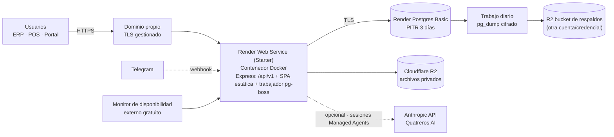
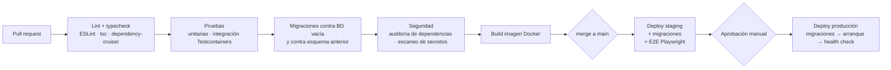

# Diseño de despliegue

> Etapa C · v0.1 · 2026-10-29
> **Estado: PROPOSED** — el proveedor de hosting requiere aprobación (P-12, ADR-020). El diseño es portable: todo se empaqueta en Docker y no usa servicios propietarios en el núcleo.

---

## 1. Topología propuesta (opción A, Render)

- **Un solo contenedor** sirve la API, los archivos estáticos de la SPA (con compresión y caché) y el trabajador de pg-boss. Con 6–15 usuarios no se justifica separar procesos (ADR-001).
- **Estimado:** ≈ USD 15/mes ≈ **$47.000 COP** (ADR-020), por debajo del techo del núcleo de $100.000 COP. IA y Telegram se miden aparte (DEC-082).
- **Alternativas** documentadas en ADR-020 (Railway; VPS Hetzner con Docker Compose). La mudanza solo cambia variables de entorno y el destino del contenedor.

## 2. Entornos

| Entorno      | Infraestructura                                                                                                                                            | Datos                                   | Acceso                |
| ------------ | ---------------------------------------------------------------------------------------------------------------------------------------------------------- | --------------------------------------- | --------------------- |
| `local`      | Docker Compose: `postgres:17`, `api` (watch), `web` (Vite dev server)                                                                                      | Semillas sintéticas                     | Desarrolladores       |
| `staging`    | Igual a producción en tamaño mínimo; puede usar plan gratuito donde exista (con la advertencia de que el Postgres gratuito de Render expira a los 30 días) | Sintéticos, sin datos personales reales | Equipo + demo IA      |
| `production` | Opción aprobada (A por defecto)                                                                                                                            | Reales                                  | Usuarios de Quatreros |

Configuración por variables de entorno (12-factor); un mismo artefacto (imagen Docker) se promueve de `staging` a `production`.

## 3. Pipeline CI/CD

- **Herramienta:** GitHub Actions (plan gratuito para repositorio privado con minutos incluidos; verificar cuota en Etapa F).
- **Migraciones en despliegue:** paso previo al arranque con el rol `quatreros_owner`; si fallan, el despliegue se detiene y queda la versión anterior.
- **Compatibilidad hacia atrás:** migraciones en dos pasos (expandir → contraer) para no romper la versión en ejecución.
- **Reversión:** volver a la imagen anterior; las migraciones de contracción solo se aplican cuando la versión nueva está estable.

## 4. Respaldo y recuperación

| Mecanismo                                            | Frecuencia            | Retención                                                | Cubre                                           |
| ---------------------------------------------------- | --------------------- | -------------------------------------------------------- | ----------------------------------------------- |
| PITR del proveedor                                   | Continuo              | 3 días (Hobby)                                           | Errores recientes, corrupción                   |
| `pg_dump` lógico cifrado (age/GPG) a R2 de respaldos | Diario 02:00 Bogotá   | 7 diarios + 4 semanales + 6 mensuales (RNF-043, PENDING) | Pérdida del proveedor, errores detectados tarde |
| Archivos en R2                                       | Versionado del bucket | 30 días de versiones                                     | Borrado accidental                              |
| Prueba de restauración                               | Trimestral (RNF-045)  | Registro en `docs/operations/restore-log.md`             | Verificar que el respaldo sirve                 |

**Objetivos propuestos (PENDING P-12):** RPO ≤ 24 h garantizado por el respaldo externo (≤ minutos dentro de la ventana PITR); RTO ≤ 4 h.

**Procedimiento de restauración (resumen):** crear BD nueva → restaurar último dump o PITR al instante elegido → ejecutar verificación de integridad (saldos vs. kardex, asientos balanceados) → apuntar `DATABASE_URL` → registrar el incidente.

## 5. Contingencia sin Internet (RNF-046, PENDING aprobación de negocio)

Sin modo offline (DEC-061). Propuesta:

1. **POS:** formulario impreso de ventas de contingencia (consecutivo, productos, pagos) → al volver la conexión, el cajero registra las ventas con marca `contingency = true` y la fecha real; auditoría lo distingue.
2. **Ruta:** el distribuidor anota entregas y cobros en planilla → registra al reconectar (la idempotencia evita duplicados si alcanzó a enviar).
3. **Indicador de conexión** visible en POS y portal; las acciones fallidas se reintentan manualmente, nunca se guardan "a medias".

## 6. Observabilidad

| Señal             | Herramienta propuesta                                                                 | Alerta                                                 |
| ----------------- | ------------------------------------------------------------------------------------- | ------------------------------------------------------ |
| Disponibilidad    | Monitor HTTP externo (plan gratuito) sobre `/health`                                  | Caída > 2 min → correo/Telegram al responsable técnico |
| Errores           | Servicio de seguimiento de errores con plan gratuito (front y back)                   | Error nuevo o pico                                     |
| Logs              | pino JSON → logs del proveedor (retención según plan)                                 | 5xx > 5 % en 5 min (RNF-093)                           |
| Salud del negocio | Trabajos pg-boss: conciliación saldo vs. kardex, colas atascadas, outbox sin publicar | Cualquier diferencia                                   |
| Consumo IA        | Tablero RF-344                                                                        | 80 % y 100 % del techo (RF-345)                        |

## 7. Variables de entorno (principales)

| Variable                                                                                                                           | Descripción                                                                                                              | Secreto            |
| ---------------------------------------------------------------------------------------------------------------------------------- | ------------------------------------------------------------------------------------------------------------------------ | ------------------ |
| `NODE_ENV`                                                                                                                         | `development` / `staging` / `production`                                                                                 | No                 |
| `APP_BASE_URL`                                                                                                                     | URL pública                                                                                                              | No                 |
| `DATABASE_URL`                                                                                                                     | Conexión rol `quatreros_app`                                                                                             | Sí                 |
| `DATABASE_MIGRATIONS_URL`                                                                                                          | Conexión rol `quatreros_owner` (solo CI/CD)                                                                              | Sí                 |
| `BETTER_AUTH_SECRET`                                                                                                               | Firma de sesiones                                                                                                        | Sí                 |
| `R2_ENDPOINT`, `R2_BUCKET`, `R2_ACCESS_KEY_ID`, `R2_SECRET_ACCESS_KEY`                                                             | Archivos                                                                                                                 | Sí (claves)        |
| `MAIL_PROVIDER_API_KEY`, `MAIL_FROM`                                                                                               | Correo transaccional                                                                                                     | Sí (clave)         |
| `ADDON_ASSISTANT_ENABLED`                                                                                                          | Bandera de arranque (la activación efectiva está en BD)                                                                  | No                 |
| `ANTHROPIC_API_KEY`, `ANTHROPIC_AGENT_ID`, `ANTHROPIC_AGENT_VERSION`, `ANTHROPIC_ENVIRONMENT_ID`, `ASSISTANT_SESSION_BUDGET_CENTS` | Asistente Quatreros AI (ai-architecture §12). IDs tomados de `quatreros-ai/claude-lock.json` del entorno correspondiente | Sí (solo la clave) |
| `TELEGRAM_BOT_TOKEN`, `TELEGRAM_WEBHOOK_SECRET`                                                                                    | Telegram                                                                                                                 | Sí                 |
| `LOG_LEVEL`                                                                                                                        | `info` por defecto                                                                                                       | No                 |
| `TZ_BUSINESS`                                                                                                                      | `America/Bogota`                                                                                                         | No                 |

Se documentan en `.env.example` sin valores (Etapa F).

## 7.1 Dos publicaciones independientes: backend y agente

| Qué se publica                                              | Cómo                                                                                                                       | Qué **no** hace                                        |
| ----------------------------------------------------------- | -------------------------------------------------------------------------------------------------------------------------- | ------------------------------------------------------ |
| Backend Express + SPA                                       | CI en verde en `main` → workflow Deploy (apagado hasta tener hosting: `DEPLOY_ENABLED`)                                    | No cambia el agente en Anthropic                       |
| Agente Quatreros AI (prompt, modelo, herramientas, entorno) | `cd quatreros-ai && ant apply --dry-run .` → revisión → `ant apply .` → commit de `claude-lock.json` (ai-architecture §11) | No despliega el backend; `git push` tampoco lo ejecuta |

- **Orden:** al agregar herramientas, primero el backend con su manejador y después `ant apply`; al quitarlas, al revés.
- **Entornos:** el lockfile actual corresponde al espacio de trabajo de **desarrollo** (metadato `environment: development`). Producción usará otro espacio de trabajo, otra clave y otro lockfile (`--lock-file`), según Q-IA-04.
- No se automatiza `ant apply` en CI sin aprobación. Si se aprueba, se haría con Workload Identity Federation, ejecuciones de a una y un entorno protegido en GitHub.

## 8. Costos (resumen)

| Concepto                               | Estimado mensual                                                                                                     | Fuente                     |
| -------------------------------------- | -------------------------------------------------------------------------------------------------------------------- | -------------------------- |
| Hosting API + SPA (Render Starter)     | USD 7                                                                                                                | ADR-020                    |
| Postgres Basic + 5 GB                  | ≈ USD 7,50                                                                                                           | ADR-020                    |
| R2 (≤ 10 GB)                           | USD 0                                                                                                                | ADR-020                    |
| Monitoreo y errores (planes gratuitos) | USD 0                                                                                                                | —                          |
| CI (GitHub Actions, cuota gratuita)    | USD 0 (verificar)                                                                                                    | —                          |
| **Total núcleo**                       | **≈ USD 15 ≈ $47.000 COP**                                                                                           | TRM ≈ $3.150 (28-oct-2026) |
| Dominio, correo transaccional          | Aparte (Q-INF-02b)                                                                                                   | —                          |
| IA, transcripción, Telegram            | Incremental, medido (RF-344). La IA cobra tokens **y** tiempo de ejecución de sesión (`list_cost`, `active_seconds`) | DEC-082, ADR-023           |
| Facturación electrónica                | Aparte, depende de P-02                                                                                              | INT-01                     |

Los precios provienen de fuentes de terceros fechadas (ADR-020) y deben verificarse en la página del proveedor al contratar.
