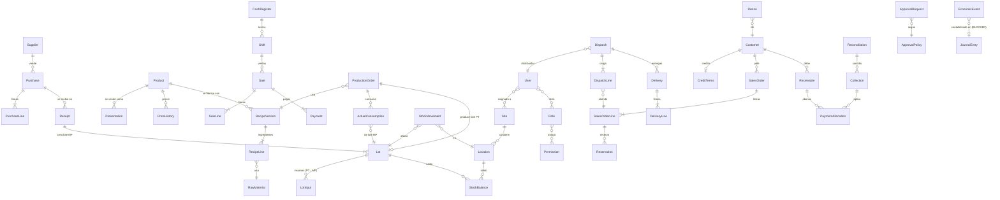

# Modelo de dominio

> Etapa C · v0.1 · 2026-10-29
> Entidades, agregados, invariantes y relaciones conceptuales. Nombres según la columna **Código** del glosario. El esquema físico está en `database-design.md`.
> **Agregado** = conjunto que se modifica como unidad dentro de una transacción; su raíz es la única entrada desde fuera.

---

## 1. Mapa de entidades y relaciones

## 2. Agregados, invariantes y estados

### 2.1 Administración

| Agregado                | Raíz                | Invariantes                                                                                    | Estados                                                                      |
| ----------------------- | ------------------- | ---------------------------------------------------------------------------------------------- | ---------------------------------------------------------------------------- |
| Usuario                 | `User`              | correo único; al menos un rol; ≥1 sede salvo alcance `ALL`; nunca se borra (BR-010)            | activo, inactivo                                                             |
| Rol                     | `Role`              | rol Administrador conserva `adm.user.*`                                                        | activo, inactivo                                                             |
| Sede                    | `Site` + `Location` | ubicación con saldo no se inactiva                                                             | activa, inactiva                                                             |
| Solicitud de aprobación | `ApprovalRequest`   | aprobador ≠ solicitante (BR-004); se consume una vez; vinculada al hash exacto de la operación | `pending → approved \| rejected \| expired`; `approved → consumed \| failed` |

### 2.2 Catálogo

| Agregado      | Raíz                                      | Invariantes                                                                                                                       |
| ------------- | ----------------------------------------- | --------------------------------------------------------------------------------------------------------------------------------- |
| Producto      | `Product` + `Presentation`                | una unidad base; composición de presentación inmutable si tiene movimientos (BR-021); un precio vigente por presentación (BR-022) |
| Receta        | `Recipe` + `RecipeVersion` + `RecipeLine` | versión inmutable al publicarse; cantidades > 0; una versión vigente                                                              |
| Materia prima | `RawMaterial`                             | unidad inmutable con movimientos                                                                                                  |

### 2.3 Compras

| Agregado  | Raíz                        | Invariantes                                        | Estados                                                                              |
| --------- | --------------------------- | -------------------------------------------------- | ------------------------------------------------------------------------------------ |
| Compra    | `Purchase` + `PurchaseLine` | recibido por línea ≤ comprado (o con confirmación) | `pending_receipt → partially_received → received \| closed_with_balance`; `→ voided` |
| Recepción | `Receipt`                   | crea un lote MP por línea recibida                 | `posted`, `reversed`                                                                 |

### 2.4 Producción

| Agregado            | Raíz                                    | Invariantes                                                                                                      | Estados                                                                   |
| ------------------- | --------------------------------------- | ---------------------------------------------------------------------------------------------------------------- | ------------------------------------------------------------------------- |
| Orden de producción | `ProductionOrder` + `ActualConsumption` | una versión de receta; cierre crea exactamente un lote PT; rendimiento fuera de tolerancia exige motivo (BR-066) | `planned → in_progress → closed`; `planned → voided`; `closed → reversed` |

### 2.5 Inventarios

| Agregado        | Raíz                                                     | Invariantes                                                                   | Estados                                                           |
| --------------- | -------------------------------------------------------- | ----------------------------------------------------------------------------- | ----------------------------------------------------------------- |
| Lote            | `Lot` (tipo `raw_material` o `finished_good`)            | vencimiento ≥ fabricación; vendible solo si `available` y no vencido (BR-086) | `available`, `in_inspection`, `blocked`, `expired`, `written_off` |
| Saldo           | `StockBalance` (por ítem, presentación, lote, ubicación) | cantidad ≥ 0 (BR-081); solo cambia junto con un `StockMovement`               | —                                                                 |
| Movimiento      | `StockMovement`                                          | inmutable; referencia a documento de origen; signo coherente con tipo         | —                                                                 |
| Traslado        | `Transfer` + líneas                                      | origen ≠ destino; recibido vs. enviado genera novedad (BR-089)                | `in_transit → received \| received_with_variance → resolved`      |
| Conteo / ajuste | `PhysicalCount`, `Adjustment`                            | ajuste con motivo; AP-05 sobre umbral                                         | `draft → posted`                                                  |
| Reserva         | `Reservation`                                            | reservado ≤ disponible al crear                                               | `active → consumed \| released`                                   |

**Tipos de movimiento:** `receipt`, `production_consumption`, `production_output`, `transfer_out`, `transfer_in`, `dispatch_out`, `dispatch_return`, `sale`, `customer_return`, `return_reinstated`, `write_off`, `adjustment`, `package_open_out`, `package_open_in`, `opening_balance`, `reversal`.

**Ubicaciones especiales (Q-B-07, PROPOSED):** "en tránsito" (por traslado), "en ruta" (por distribuidor), "en inspección" (devoluciones). Se modelan como `Location` de tipo especial para que la mercancía nunca "desaparezca" entre dos puntos.

### 2.6 Comercial y distribución

| Agregado   | Raíz                       | Invariantes                                                                      | Estados                                                                                                      |
| ---------- | -------------------------- | -------------------------------------------------------------------------------- | ------------------------------------------------------------------------------------------------------------ |
| Cliente    | `Customer` + `CreditTerms` | identificación única si existe; cupo/plazo solo por ADM                          | activo, inactivo                                                                                             |
| Pedido     | `SalesOrder` + líneas      | precio fijado al confirmar (BR-024, PENDING); pendiente = pedido − entregado ≥ 0 | `draft → pending_approval → confirmed → in_dispatch → partially_delivered → delivered`; `→ cancelled` (P-09) |
| Despacho   | `Dispatch` + líneas        | un distribuidor; entregado + devuelto + sobrante = cargado (al liquidar)         | `prepared → in_route → to_settle → settled`                                                                  |
| Entrega    | `Delivery` + líneas        | entregado ≤ cargado por línea                                                    | `posted`                                                                                                     |
| Devolución | `Return`                   | queda en inspección hasta decisión (BR-125)                                      | `in_inspection → reinstated \| written_off`                                                                  |

### 2.7 POS y cocina

| Agregado          | Raíz                      | Invariantes                                                                     | Estados                                            |
| ----------------- | ------------------------- | ------------------------------------------------------------------------------- | -------------------------------------------------- |
| Turno             | `Shift`                   | un turno abierto por caja y por cajero (BR-141); diferencia exige justificación | `open → closed \| closed_with_variance → reviewed` |
| Venta             | `Sale` + líneas + pagos   | Σ pagos − cambio = total (BR-143); solo con turno abierto                       | `completed`; `→ voided` (P-09)                     |
| Período de cocina | `KitchenPeriod` + conteos | diferencia = inicial + entradas − final − teórico (BR-148)                      | `open → counted → classified` (P-07)               |

### 2.8 Finanzas

| Agregado     | Raíz                        | Invariantes                                                                 | Estados                                               |
| ------------ | --------------------------- | --------------------------------------------------------------------------- | ----------------------------------------------------- |
| Obligación   | `Receivable`                | saldo ≥ 0; vence = origen + plazo (BR-172)                                  | `open → partially_paid → paid`                        |
| Recaudo      | `Collection` + asignaciones | responsable (distribuidor o caja) obligatorio; suma de asignaciones ≤ monto | `registered → reconciled \| reconciled_with_variance` |
| Conciliación | `Reconciliation`            | diferencia = recibido − registrado                                          | `posted`                                              |

### 2.9 Contabilidad

| Agregado        | Raíz                                       | Invariantes                             | Estado de implementación               |
| --------------- | ------------------------------------------ | --------------------------------------- | -------------------------------------- |
| Hecho económico | `EconomicEvent`                            | inmutable; referencia al origen         | Construible                            |
| Comprobante     | `Voucher` + `JournalEntry` + `JournalLine` | Σ débitos = Σ créditos; período abierto | Estructura construible; reglas BLOCKED |
| Período         | `AccountingPeriod`                         | cerrado = sin nuevos asientos           | Construible                            |

### 2.10 Complementos

| Agregado               | Raíz                | Invariantes                                                           |
| ---------------------- | ------------------- | --------------------------------------------------------------------- |
| Propuesta de operación | `OperationProposal` | hash de datos inmutable; expira; se confirma una vez; ejecución única |
| Vínculo Telegram       | `TelegramLink`      | un chat ↔ un usuario activo                                           |

## 3. Correspondencia proceso ↔ entidades

| Flujo                    | Entidades que crea o modifica                                                                      |
| ------------------------ | -------------------------------------------------------------------------------------------------- |
| WF-01 Compra y recepción | Purchase, PurchaseLine, Receipt, Lot (MP), StockMovement, StockBalance, EconomicEvent, AuditLog    |
| WF-02 Producción         | ProductionOrder, ActualConsumption, Lot (PT), LotInput, StockMovement, StockBalance, EconomicEvent |
| WF-03 Traslado           | Transfer, StockMovement ×2, StockBalance                                                           |
| WF-04 Pedido → entrega   | SalesOrder, Reservation, Dispatch, Delivery, Return, Receivable, Collection, StockMovement         |
| WF-05 Venta POS          | Shift, Sale, SaleLine, Payment, StockMovement, EconomicEvent                                       |
| WF-06 Cocina             | KitchenPeriod, KitchenCount, (consumo teórico derivado de SaleLine + DishRecipe)                   |
| WF-07 Crédito            | CreditTerms, Receivable, PaymentAllocation, ApprovalRequest                                        |
| WF-08 Conciliación       | Collection, Reconciliation                                                                         |
| WF-09 Aprobaciones       | ApprovalRequest                                                                                    |
| WF-10 IA                 | OperationProposal, AiRequest, + entidades de la operación ejecutada                                |
| WF-11 Carga inicial      | Entidades maestras + StockMovement/Receivable `opening_balance`                                    |

Todas las entidades de `data-requirements.md` tienen correspondencia en este modelo y en el esquema físico.
