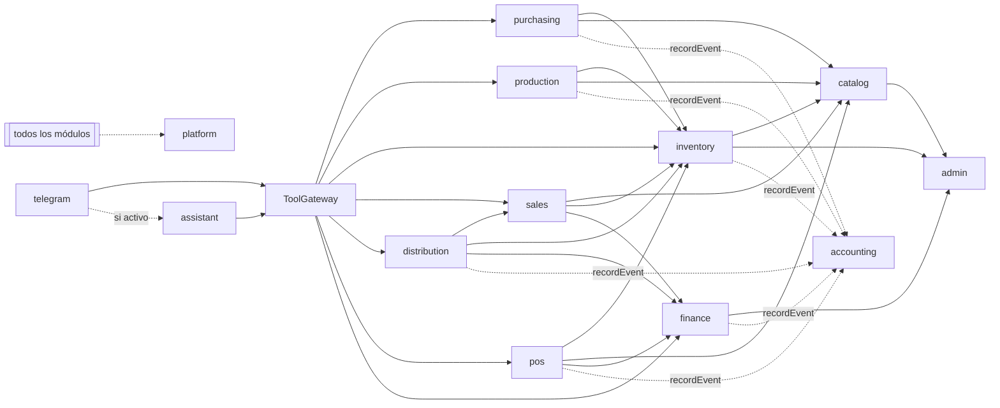

# Fronteras de módulos

> Etapa C · v0.1 · 2026-10-29
> Cada módulo es dueño de su esquema de base de datos y expone un servicio público. Otros módulos **no leen ni escriben sus tablas** (ADR-001). Las referencias entre esquemas se hacen con llaves foráneas solo hacia tablas maestras estables (ver §3).

---

## 1. Mapa de módulos

| Módulo (código) | Nombre de negocio         | Esquema BD          | Responsabilidad                                                                                                  | Requerimientos                 |
| --------------- | ------------------------- | ------------------- | ---------------------------------------------------------------------------------------------------------------- | ------------------------------ |
| `admin`         | Administración            | `admin`             | Usuarios, roles, permisos, sedes, ubicaciones, políticas y solicitudes de aprobación                             | RF-001–008, BR-001–010         |
| `catalog`       | Catálogo y precios        | `catalog`           | Productos, presentaciones, materias primas, precios e histórico, recetas de producción y de platos               | RF-030–033, RF-225, BR-020–025 |
| `purchasing`    | Compras                   | `purchasing`        | Proveedores, compras, recepciones (crea lotes MP vía `inventory`)                                                | RF-050–053, BR-040–044         |
| `production`    | Producción                | `production`        | Sugerencias, órdenes, consumo real, cierre y rendimiento                                                         | RF-080–084, BR-060–068         |
| `inventory`     | Inventarios               | `inventory`         | Lotes (MP y PT), kardex, saldos, reservas, FEFO, traslados, conteos, ajustes, aperturas de paquete, trazabilidad | RF-110–119, BR-080–093         |
| `sales`         | Comercial                 | `sales`             | Clientes, pedidos, líneas, estados y pendientes                                                                  | RF-150–153, BR-110–114         |
| `distribution`  | Distribución              | `distribution`      | Despachos, asignación, entregas, devoluciones e inspección, liquidación                                          | RF-180–186, BR-120–128         |
| `pos`           | POS y cocina              | `pos`               | Cajas, turnos, ventas, pagos, cierres, revisión de diferencias, conteos y diferencias de cocina                  | RF-220–227, BR-140–150         |
| `finance`       | Finanzas (cartera y caja) | `finance`           | Condiciones de crédito, obligaciones, abonos, recaudos, conciliaciones, reportes operativos                      | RF-260–266, BR-170–178         |
| `accounting`    | Contabilidad              | `accounting`        | Hechos económicos, plan de cuentas, comprobantes, asientos, períodos, reportes contables                         | RF-300–305, BR-200–207         |
| `platform`      | Plataforma (técnico)      | `platform`, `audit` | Auditoría, idempotencia, outbox, archivos, ajustes de complementos, migraciones de carga inicial                 | BR-005, BR-007, RF-375–376     |
| `assistant`     | Asistente IA (opcional)   | `assistant`         | Conversaciones, propuestas, confirmaciones, consumo, límites                                                     | RF-340–345, BR-230–237         |
| `telegram`      | Telegram (opcional)       | `telegram`          | Vínculos, actualizaciones recibidas, comandos, notificaciones                                                    | RF-370–372, BR-250–253         |

## 2. Responsabilidades y límites por módulo

### admin

- **Hace:** autenticación (con Better Auth), autorización (`authz.require`), sedes/ubicaciones, motor de aprobaciones (crea solicitudes, registra decisiones, entrega una **aprobación de un solo uso** al caso de uso solicitante).
- **No hace:** ejecutar la operación aprobada (la ejecuta su módulo dueño al re-invocar el caso de uso con el `approvalId`).
- **Público:** `authz.require()`, `authz.scopeFilter()`, `approvals.request()`, `approvals.consume()`, `sites.get()`.

### catalog

- **Hace:** maestros de producto/MP y precios; conversión presentación → unidad base; recetas versionadas.
- **No hace:** existencias (es de `inventory`).
- **Público:** `getProduct()`, `toBaseUnits()`, `currentPrice()`, `getRecipeVersion()`.
- **Eventos:** `PriceChanged` (auditado).

### purchasing

- **Hace:** compras y recepciones. Al recibir, llama a `inventory.receiveRawMaterial()` dentro de la misma transacción.
- **No hace:** impuestos (BLOCKED P-02), pagos a proveedores (cuentas por pagar: alcance a confirmar con el contador).
- **Eventos económicos:** `PurchaseReceived`.

### production

- **Hace:** sugerencias (lee disponibilidad de `inventory` y puntos de reorden), órdenes, consumo y cierre. Llama a `inventory.consume()` y `inventory.produceLot()`.
- **No hace:** costo oficial del lote (BLOCKED P-03): solo captura cantidades y costos de MP consumida.
- **Eventos económicos:** `ProductionCompleted`.

### inventory (núcleo del núcleo)

- **Hace:** única puerta para cambiar existencias (ADR-009); asignación FEFO; reservas; traslados (con estados en tránsito, Q-B-07); conteos/ajustes; trazabilidad.
- **Público:** `allocateFefo()`, `issueStock()`, `receiveStock()`, `reserve()/release()`, `transfer()`, `openPackage()` (deshabilitado hasta P-06), `availability()`, `traceLot()`.
- **Invariantes:** saldo ≥ 0 (BR-081, configurable por Q-B-08); movimiento inmutable; lote vendible solo si `available` y no vencido.
- **Eventos económicos:** `StockAdjusted`, `StockWrittenOff`.

### sales

- **Hace:** clientes y pedidos. Al confirmar, pide a `finance.checkCredit()` y a `inventory.reserve()`.
- **No hace:** entregas (es `distribution`), cartera (es `finance`).

### distribution

- **Hace:** despachos, entregas (actualiza pendientes del pedido vía `sales.registerDelivered()`), devoluciones, inspección, liquidación (PENDING P-08).
- **Llama a:** `inventory.issueStock()` (salida a ubicación "en ruta"), `finance.createReceivable()`, `finance.registerCollection()`.

### pos

- **Hace:** turnos, ventas y pagos, cierres; cocina (consumo teórico, conteos).
- **Llama a:** `inventory.issueStock()` (fabricados), `catalog.getRecipeVersion()` (platos).
- **No hace:** documento fiscal (BLOCKED P-02, adaptador futuro).
- **Eventos económicos:** `SaleCompleted`, `ShiftClosed`.

### finance

- **Hace:** crédito (cupo, plazo, verificación y disparo de aprobación AP-01/02), obligaciones, abonos, recaudos, conciliaciones, reportes operativos.
- **Eventos económicos:** `ReceivableCreated`, `PaymentReceived`, `CollectionReconciled`.

### accounting

- **Hace:** registra hechos económicos de todos los módulos (los módulos insertan vía `accounting.recordEvent()` en su transacción); capa genérica de cuentas, comprobantes, asientos y períodos.
- **No hace (BLOCKED):** reglas de contabilización, impuestos, costeo, plan de cuentas concreto.

### platform

- **Hace:** `audit.record()`, middleware de idempotencia, `outbox.publish()`, archivos firmados, ajustes de complementos, carga inicial.

### assistant / telegram

- **Hacen:** ver `ai-architecture.md` y `telegram-architecture.md`.
- **Límite duro:** sin acceso a BD del núcleo; sin importación desde el núcleo hacia ellos.
- **Estructura prevista de `src/addons/assistant/`** (ADR-023; sigue las capas de los módulos del núcleo):

```
src/addons/assistant/
├── domain/                  propuesta y sus estados, política de presupuesto, límites por turno (puro)
├── application/             SessionService, TurnRunner, ToolDispatcher, ProposalService, UsageMeter, BudgetGuard
├── infrastructure/
│   ├── schema.ts            esquema `assistant` (conversations, tool_calls, proposals, requests)
│   └── anthropic/           AnthropicClient: @anthropic-ai/sdk (beta.sessions), stream SSE, reintentos
└── http/                    /assistant/conversations, /messages, /stream (SSE), /proposals/{id}/confirm|cancel, /usage
```

- El SDK de Anthropic **solo** se importa desde `infrastructure/anthropic/`; ningún otro archivo del backend lo conoce.
- El asistente no tiene casos de uso de negocio propios: toda herramienta resuelve a un caso de uso existente a través de `src/addons/tool-gateway/`.

## 3. Dependencias permitidas



- No se permiten ciclos. Si dos módulos necesitan comunicarse en ambos sentidos, el segundo sentido va por **evento de outbox**.
- **Llaves foráneas entre esquemas:** permitidas solo hacia `admin.users`, `admin.sites`, `admin.locations`, `catalog.products`, `catalog.presentations`, `catalog.raw_materials`, `sales.customers`, `purchasing.suppliers` y `inventory.lots` (maestros estables). Todo lo demás se referencia por id sin FK o vía servicio.

## 4. Transacciones que cruzan módulos

Los módulos comparten la misma conexión transaccional: el caso de uso dueño abre la transacción (`db.transaction(tx => …)`) y la pasa a los servicios públicos de los otros módulos. Ejemplos:

| Caso de uso dueño               | Participantes en la misma transacción                                                                 |
| ------------------------------- | ----------------------------------------------------------------------------------------------------- |
| `purchasing.ReceivePurchase`    | inventory (lote MP + entrada), accounting (evento), platform (auditoría)                              |
| `production.CloseOrder`         | inventory (consumos + lote PT + entrada), accounting, platform                                        |
| `sales.ConfirmOrder`            | finance (verificación de crédito / solicitud de aprobación), inventory (reserva), platform            |
| `distribution.DispatchOut`      | inventory (FEFO + salida a "en ruta"), platform                                                       |
| `distribution.RegisterDelivery` | sales (pendientes), finance (obligación / recaudo), inventory (liberar reserva), accounting, platform |
| `pos.RegisterSale`              | inventory (FEFO + salida), finance (pagos), accounting, platform                                      |

## 5. Flags de módulos bloqueados

| Capacidad                              | Flag                                           | Por defecto | Se habilita cuando                   |
| -------------------------------------- | ---------------------------------------------- | ----------- | ------------------------------------ |
| Apertura de paquete                    | `feature.inventory.packageOpening`             | off         | P-06 resuelto                        |
| Liquidación de distribuidor            | `feature.distribution.settlement`              | off         | P-08 resuelto                        |
| Clasificación de diferencias de cocina | `feature.pos.kitchenVarianceAdjust`            | off         | P-07 resuelto                        |
| Descuentos y anulaciones               | `feature.sales.discounts`, `feature.pos.voids` | off         | P-09 resuelto                        |
| Contabilización automática             | `feature.accounting.posting`                   | off         | P-01..P-04 resueltos                 |
| Documento fiscal                       | `feature.pos.fiscalDocument`                   | off         | P-02 resuelto                        |
| Escrituras asistidas                   | `feature.assistant.writes`                     | off         | Matriz de permisos aprobada (Q-B-01) |
