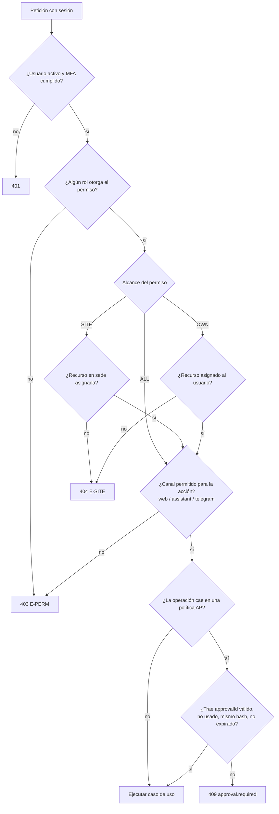

# Diseño de seguridad

> Etapa C · v0.1 · 2026-10-29
> Cubre autenticación, autorización RBAC con sede y alcance, aprobaciones, auditoría, protección de datos y amenazas principales. La **matriz de permisos** inicial está en `01-requirements/actors-permissions.md` (PROPOSED, Q-B-01).

---

## 1. Modelo de amenazas (resumen)

| Activo                  | Amenaza                                             | Control                                                                             | Ref.             |
| ----------------------- | --------------------------------------------------- | ----------------------------------------------------------------------------------- | ---------------- |
| Dinero (caja, recaudos) | Registro falso o borrado de ventas/recaudos         | Inmutabilidad, auditoría, conciliación, segregación                                 | BR-006, BR-177   |
| Inventario              | Ajustes no autorizados; sobreventa concurrente      | Ajuste con motivo y AP-05; bloqueo de saldos + `CHECK`                              | BR-091, ADR-009  |
| Crédito                 | Venta sobre cupo saltándose la UI                   | Verificación en backend dentro de la transacción                                    | BR-171, R-FIN-02 |
| Cuentas privilegiadas   | Robo de credenciales de ADM/MGR/CONT                | MFA, bloqueo por intentos, sesiones revocables                                      | ACC-02           |
| Datos de otras sedes    | IDOR (cambiar un id en la URL)                      | Alcance verificado en el caso de uso; 404 para recursos ajenos                      | BR-001           |
| Asistente IA            | Inyección de instrucciones; acciones no confirmadas | Herramientas tipadas, permisos del usuario, confirmación humana, sin SQL            | R-IA-04          |
| Telegram                | Suplantación de cuenta                              | Vinculación por código de un solo uso, verificación adicional en acciones sensibles | R-SEC-04         |
| Secretos                | Exposición en repositorio o logs                    | Gestor de secretos, escaneo en CI, redacción de logs                                | RNF-007, RNF-092 |
| Respaldos               | Pérdida o filtración                                | Cifrado, copia externa, prueba de restauración                                      | RNF-041..045     |

## 2. Autenticación

| Elemento      | Diseño                                                                                                                                                                           |
| ------------- | -------------------------------------------------------------------------------------------------------------------------------------------------------------------------------- |
| Librería      | Better Auth `^1.7` (ADR-007) con adaptador Drizzle; tablas en esquema `auth`                                                                                                     |
| Credenciales  | Correo + contraseña (mín. 12 caracteres; verificación contra contraseñas filtradas — propuesta)                                                                                  |
| Hash          | El algoritmo por defecto de la librería (scrypt) o Argon2id; nunca reversible                                                                                                    |
| MFA           | Plugin `two-factor` TOTP. Obligatorio si algún rol del usuario tiene `requires_mfa = true` (propuesto: ADM, MGR, CONT — Q-SEC-02). Códigos de respaldo de un solo uso            |
| Sesión        | En base de datos; cookie `HttpOnly; Secure; SameSite=Lax`; rotación al iniciar sesión y al cambiar privilegios; expiración por inactividad distinta por shell (RNF-006, PENDING) |
| Bloqueo       | Límite de intentos por cuenta e IP (RNF-005, PENDING)                                                                                                                            |
| Recuperación  | Enlace de un solo uso con expiración; cierra otras sesiones; restablecer MFA solo por ADM (auditado)                                                                             |
| Desactivación | Usuario inactivo → todas sus sesiones y su vínculo de Telegram se revocan inmediatamente                                                                                         |

## 3. Autorización: RBAC + sede + alcance + aprobaciones

### 3.1 Evaluación



- **Alcance múltiple:** si un usuario tiene el mismo permiso por dos roles con alcances distintos, se aplica el **más amplio**.
- **Canal:** cada permiso declara canales admitidos. Por defecto: `web` todos; `assistant`/`telegram` solo lectura hasta aprobar la matriz (BR-234); luego, lista blanca de operaciones de escritura (Q-IA-03).
- **Caché:** permisos efectivos del usuario en memoria por petición; se invalidan al cambiar roles (versión de permisos en la sesión).

### 3.2 Implementación

```ts
// application/use-cases/register-delivery.ts (ilustrativo)
await authz.require(ctx, 'dis.delivery.register', { siteId: dispatch.siteId, ownerId: dispatch.driverId });
```

- `authz.require` vive en `admin/application/public.ts`; es la **única** función que decide permisos (una sola fuente de verdad, PM §4.D).
- Pruebas obligatorias por caso de uso de escritura: permitido, sin permiso (403), sede ajena (404), no propietario con alcance `OWN` (404), canal no permitido (403).

### 3.3 Aprobaciones (AP-01..AP-10)

1. El caso de uso detecta la excepción y devuelve `409 approval.required` con la política.
2. Si el usuario envía motivo, se crea `approval_request` con **payload normalizado y su hash**.
3. El aprobador (distinto, BR-004) aprueba en la bandeja (web o Telegram si está activo).
4. El solicitante (o el sistema, para la IA) re-ejecuta la operación con `approvalId`.
5. El caso de uso verifica: misma operación, mismo hash, estado `approved`, no expirada → la marca `consumed` **en la misma transacción** de la operación → ejecuta.
6. Si la revalidación de negocio falla (p. ej. ya no hay existencia), la aprobación pasa a `failed` y se informa.

## 4. Auditoría

| Aspecto          | Diseño                                                                                                                                                                               |
| ---------------- | ------------------------------------------------------------------------------------------------------------------------------------------------------------------------------------ |
| Qué se audita    | Catálogo mínimo de BR-005 + inicio/cierre de sesión, cambios de MFA, exportaciones de datos personales, activación de complementos, toda ejecución desde IA o Telegram               |
| Contenido        | Usuario, roles, sede, **canal**, acción (= código de permiso), entidad, antes/después (solo campos cambiados), motivo, aprobación, propuesta IA, `requestId`, IP                     |
| Dónde se escribe | En la misma transacción que la operación (si la operación falla, no queda auditoría de éxito); intentos denegados de acciones sensibles se registran aparte, fuera de la transacción |
| Integridad       | Tabla solo-inserción con trigger + rol de aplicación sin `UPDATE/DELETE` (ADR-012, ADR-013)                                                                                          |
| Acceso           | ADM (todo), MGR (su sede), CONT (todo, lectura)                                                                                                                                      |
| Retención        | Sin borrado; plazo legal con el contador (DR-020)                                                                                                                                    |
| Datos sensibles  | No se guardan contraseñas, tokens ni secretos; documentos de identidad enmascarados en `before/after`                                                                                |

## 5. Seguridad de la aplicación web

| Control      | Detalle                                                                                                                 |
| ------------ | ----------------------------------------------------------------------------------------------------------------------- |
| Cabeceras    | `helmet`: CSP estricta (solo orígenes propios + R2 firmado), `frame-ancestors 'none'`, HSTS, `Referrer-Policy`          |
| CSRF         | Cookie `SameSite=Lax` + token anti-CSRF en cabecera para `POST/PUT/PATCH/DELETE`                                        |
| CORS         | Solo el origen propio de la SPA                                                                                         |
| Entrada      | Zod `strict`; consultas parametrizadas (Drizzle); sin SQL dinámico con texto del usuario                                |
| Salida       | React escapa por defecto; prohibido `dangerouslySetInnerHTML` (regla de lint)                                           |
| Archivos     | Subida firmada directa a R2 con tipo y tamaño limitados; descarga con URL firmada de corta duración; nombres aleatorios |
| Límites      | `express-rate-limit` en auth (estricto) y API general; webhook de Telegram con secreto                                  |
| Dependencias | Auditoría en CI; Renovate/Dependabot semanal                                                                            |
| Errores      | Sin trazas internas al cliente; `requestId` para soporte                                                                |

## 6. Base de datos

- Roles `quatreros_owner` (migraciones), `quatreros_app` (aplicación), `quatreros_readonly` (respaldos/soporte) — ADR-013.
- `quatreros_app`: sin DDL; sin `UPDATE/DELETE` en `audit.audit_log`, `inventory.stock_movements`, `accounting.journal_entries`; `UPDATE` solo de la columna `posting_status` en `accounting.economic_events`.
- Conexión TLS obligatoria al proveedor gestionado.
- **El asistente y Telegram no tienen credenciales de base de datos** (RNF-009).

## 7. Secretos y configuración

| Secreto                                         | Dónde vive                                           |
| ----------------------------------------------- | ---------------------------------------------------- |
| `DATABASE_URL` (por rol)                        | Gestor de variables del hosting                      |
| `BETTER_AUTH_SECRET`                            | Ídem; rotación documentada                           |
| `AI_PROVIDER_API_KEY`                           | Ídem; solo si el complemento está contratado         |
| `TELEGRAM_BOT_TOKEN`, `TELEGRAM_WEBHOOK_SECRET` | Ídem                                                 |
| `R2_ACCESS_KEY_ID`, `R2_SECRET_ACCESS_KEY`      | Ídem; credenciales con permisos solo sobre el bucket |
| `BACKUP_ENCRYPTION_KEY`                         | Fuera del proveedor de BD                            |

- `.env.example` con nombres y descripción, **sin valores**. Escaneo de secretos en CI y en hook de pre-commit.

## 8. Protección de datos personales

- Minimización (DR-023): de personas naturales solo nombre, teléfono, dirección de entrega y, si lo exige lo fiscal, identificación.
- Política de tratamiento aprobada por la empresa antes de producción (RNF-021).
- Al proveedor de IA solo se envían los resultados de herramientas que el usuario ya tiene derecho a ver; los identificadores personales se pueden enmascarar en las respuestas de herramientas (propuesto).
- Audios de Telegram: se transcriben y se descartan (DR-022).

## 9. Seguridad de IA y Telegram (resumen; detalle en sus documentos)

- El modelo **no** decide permisos ni ejecuta: propone. El backend valida, el humano confirma, el backend ejecuta.
- Datos provenientes de la BD (nombres, notas) se tratan como **datos, no instrucciones**; las herramientas no aceptan texto libre como comando.
- Lista blanca de herramientas de escritura; operaciones excluidas por defecto: cambios de precio, permisos, crédito, ajustes, contabilidad, anulaciones (propuesta para Q-IA-03).
- Telegram: acciones sensibles exigen confirmación en el ERP web o código TOTP (DEC-P08, propuesto).
