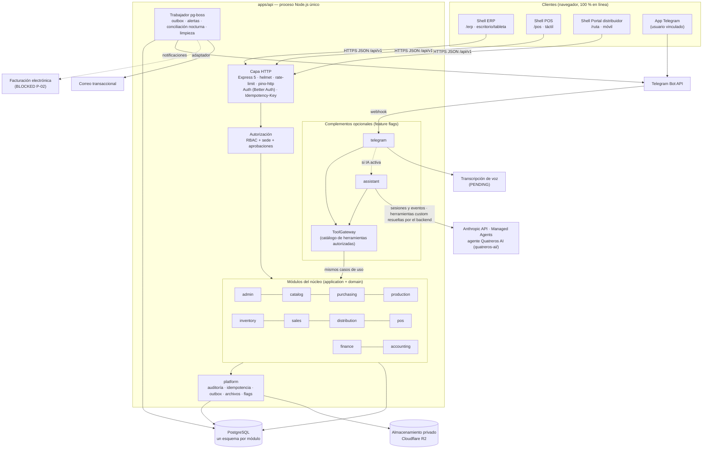
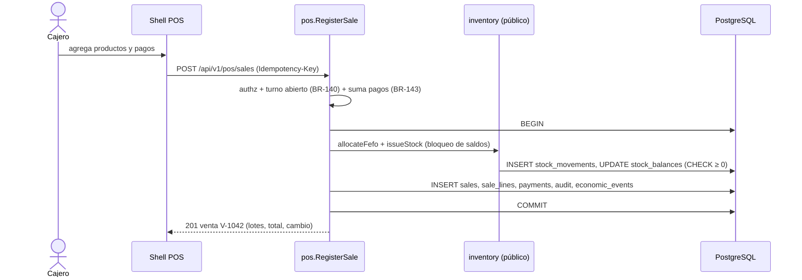

# Visión general del sistema

> Etapa C · v0.1 · 2026-10-29
> Arquitectura: **monolito modular** (ADR-001) en Node.js/Express/TypeScript con PostgreSQL, SPA React con tres shells (ADR-014), complementos IA y Telegram aislados (ADR-015). El asistente es el agente **Quatreros AI** sobre Anthropic Managed Agents (ADR-023); su configuración vive en `quatreros-ai/`.

---

## 1. Diagrama de componentes



**Reglas de dependencia (verificadas con dependency-cruiser):**

1. `CORE` nunca importa `assistant`, `telegram` ni `ToolGateway`.
2. Un módulo del núcleo solo llama a otro a través de su **servicio público** (`<modulo>/application/public.ts`), nunca a sus repositorios ni tablas.
3. `domain/` no importa Express, Drizzle ni librerías de infraestructura.
4. Los complementos no acceden a la base de datos; solo usan `ToolGateway`.

### 1.1 Vista conceptual con Quatreros AI y Telegram

```text
                         QUATREROS
                             |
            +----------------+----------------+
            |                |                |
           ERP              POS          Distribución          Telegram (canal independiente,
            |                |                |                 contratación aparte, DEC-076)
            +----------------+----------------+                       |
                             |                                        |
                      Backend Express  <------------------------------+
                             |
            +----------------+-----------------+
            |                                  |
   Servicios empresariales          Integración de IA (src/addons/assistant)
   (casos de uso + ToolGateway)                |
            |                           Anthropic API
        PostgreSQL                             |
   (fuente de verdad, DEC-088)       Quatreros AI · Managed Agent
                                     (configuración en quatreros-ai/)
```

- Las conexiones son **conceptuales**: el módulo de IA y el `ToolGateway` todavía no están implementados (ai-architecture §14).
- **Telegram** usa los servicios empresariales para comandos y notificaciones sin IA (alcance PENDING, P-13 / Q-C-04). Solo cuando el asistente está contratado, activo y el usuario autorizado, Telegram reenvía mensajes libres a la integración de IA (`channel = telegram`). Cualquiera de los dos complementos puede estar encendido o apagado sin afectar al otro ni al núcleo.
- Quatreros AI nunca llama al backend ni a PostgreSQL. **El backend** abre las sesiones, recibe las solicitudes de herramientas y las resuelve contra los servicios empresariales.

## 2. Capas de un módulo

```
apps/api/src/modules/<modulo>/
├── domain/          entidades, objetos de valor, reglas BR puras (sin E/S)
├── application/     casos de uso (transacción, permisos, auditoría, eventos)
│   └── public.ts    API pública del módulo para otros módulos y para ToolGateway
├── infrastructure/  repositorios Drizzle, adaptadores externos
└── http/            rutas Express, validación con contratos Zod, mapeo de errores
```

Un **caso de uso** típico (p. ej. `RegisterDelivery`):

1. Recibe comando validado + `ExecutionContext` (usuario, roles, sedes, canal: `web | assistant | telegram | system`, clave de idempotencia).
2. Verifica permiso y alcance de sede (`authz.require('dis.delivery.register', { siteId, ownerId })`).
3. Abre transacción → bloquea filas necesarias → aplica reglas del dominio → persiste → escribe auditoría → inserta hechos económicos/outbox → confirma.
4. Devuelve resultado con identificadores reales.

## 3. Flujos principales

### 3.1 Venta POS (WF-05)



### 3.2 Entrega en ruta (WF-04)

Portal `/ruta` → `POST /api/v1/distribution/deliveries` → valida que el despacho es del distribuidor (alcance `OWN`) → registra entregado/pendiente → crea obligación si es a crédito → actualiza pedido → auditoría. Reintentos del móvil son seguros por `Idempotency-Key`.

### 3.3 Escritura asistida (WF-10)

Asistente → `ToolGateway.prepare(tool, args, ctx)` → propuesta persistida con hash y expiración → resumen al usuario → `POST /api/v1/assistant/proposals/:id/confirm` (acción **humana**, no del modelo) → aprobación si aplica → `ToolGateway.execute` invoca el **mismo caso de uso** que la UI → resultado real. Detalle en `ai-architecture.md`.

### 3.4 Hechos económicos y contabilidad

Cada caso de uso con efecto económico inserta un `economic_event` en su transacción. Mientras P-01..P-04 estén bloqueados, los eventos quedan `pending_posting` y el contador los consulta. Cuando se aprueben las reglas, un trabajo de pg-boss los contabiliza (ADR-021).

## 4. Atributos de calidad y cómo se logran

| Atributo                    | Mecanismo                                                              | RNF          |
| --------------------------- | ---------------------------------------------------------------------- | ------------ |
| Consistencia transaccional  | Transacción por caso de uso; bloqueo de saldos; outbox                 | RNF-047      |
| Seguridad                   | Auth + MFA; RBAC y sede en backend; mínimo privilegio en BD; IA sin BD | RNF-001..010 |
| Trazabilidad                | Kardex inmutable; auditoría append-only; lotes N:M                     | RNF-090      |
| Desacople de complementos   | Feature flags; ToolGateway; reglas de dependencia                      | RNF-130      |
| Resiliencia ante reintentos | Idempotency-Key en escrituras críticas                                 | BR-007       |
| Costo                       | Un proceso + una BD gestionada + R2 gratis                             | RNF-110      |
| Portabilidad                | Docker; sin servicios propietarios en el núcleo                        | ADR-020      |

## 5. Entornos

| Entorno      | Propósito                                           | Datos                                      |
| ------------ | --------------------------------------------------- | ------------------------------------------ |
| `local`      | Desarrollo (Docker Compose: PostgreSQL + API + web) | Semillas sintéticas                        |
| `staging`    | Pruebas de aceptación y demo de IA                  | Sintéticos; nunca datos reales de clientes |
| `production` | Operación                                           | Reales                                     |

Detalle en `deployment-design.md`.
