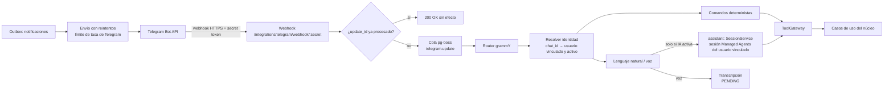
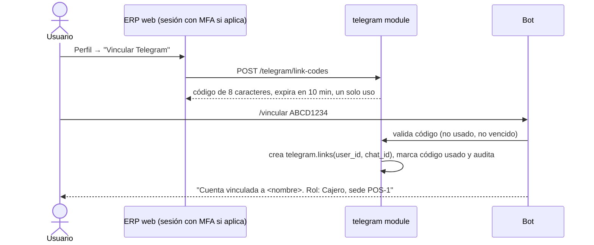

# Arquitectura de Telegram

> Etapa C/E · v0.1 · 2026-10-29
> Complemento **independiente** del asistente (DEC-076): se puede habilitar ninguno, solo IA, solo Telegram o ambos. **Las funciones que Telegram ofrece sin IA siguen PENDING (P-13)**; aquí se diseña la arquitectura que soporta cualquiera de las dos respuestas y se propone una clasificación para aprobar.

---

## 1. Combinaciones soportadas

| IA  | Telegram | Resultado                                                                                                |
| --- | -------- | -------------------------------------------------------------------------------------------------------- |
| ✗   | ✗        | Solo ERP/POS/Portal                                                                                      |
| ✓   | ✗        | Chat del asistente en la web                                                                             |
| ✗   | ✓        | Bot con **comandos estructurados** y notificaciones (sin lenguaje natural ni voz) — alcance PENDING P-13 |
| ✓   | ✓        | Bot con comandos + lenguaje natural y voz que se delegan al asistente                                    |

El módulo `telegram` consulta `platform.addon_settings` en cada mensaje: si el asistente está apagado, nunca lo invoca.

**Con Quatreros AI (ADR-023):** Telegram nunca habla con Anthropic. Entrega el texto (o la transcripción) al `SessionService` del asistente con el usuario interno vinculado y `channel = telegram`. Ese usuario tiene su **propia** sesión de Managed Agents, distinta de la del chat web. Las respuestas, propuestas y resultados vuelven por el bot. Las funciones de Telegram sin IA siguen PENDING (P-13, Q-C-04).

## 2. Componentes

- **Webhook rápido:** responde 200 en cuanto persiste el `update_id` y encola; el procesamiento ocurre en el trabajador (evita reintentos de Telegram por lentitud).
- **Idempotencia:** `telegram.updates.update_id` es llave primaria (RNF-132).
- **Envíos salientes** pasan por el outbox con reintentos exponenciales y respeto del límite de tasa de la API; si Telegram está caído, nada del núcleo se bloquea (RNF-130).

## 3. Vinculación segura de cuentas (RF-370, BR-250)

- Un chat ↔ un usuario. Solo chats **privados** (se ignoran grupos).
- Al desactivar el usuario o revocar el vínculo, el bot deja de responder datos de inmediato.
- Mensajes de chats no vinculados: solo instrucciones de vinculación, sin datos.

## 4. Permisos y confirmaciones

- Cada mensaje construye el `ExecutionContext` del usuario vinculado con `channel = telegram`; se aplica exactamente la misma autorización que en la web (BR-251).
- Permiso adicional por canal: cada acción declara si se admite en `telegram` (security-design §3.1).
- **Escrituras:** mismo flujo de propuesta → resumen → confirmación que en la IA (los comandos deterministas también crean propuesta). La confirmación es un botón _inline_ con el id de la propuesta, de un solo uso y con expiración.
- **Acciones sensibles** (propuesta DEC-P08): requieren además confirmar en el ERP web o ingresar el código TOTP del usuario.

## 5. Clasificación de funciones (PROPUESTA para resolver P-13)

| Función                                                                                            | ¿Requiere IA?                           | Implementación                                    | Propuesta                        |
| -------------------------------------------------------------------------------------------------- | --------------------------------------- | ------------------------------------------------- | -------------------------------- |
| Vinculación y desvinculación                                                                       | No                                      | Comando `/vincular`, `/desvincular`               | Incluida en Telegram base        |
| Notificaciones (aprobaciones pendientes, lotes por vencer, existencia baja, cierre con diferencia) | No                                      | Outbox → mensaje con plantilla                    | Incluida en Telegram base        |
| **Aprobar/rechazar** solicitudes desde la notificación                                             | No                                      | Botones inline + verificación adicional           | Incluida en Telegram base        |
| Consultas fijas: `/existencias <producto>`, `/cartera <cliente>`, `/pedidos`, `/turno`             | No                                      | Comandos con parámetros + herramientas de lectura | Incluida en Telegram base        |
| Registros estructurados (p. ej. `/traslado`) mediante formulario guiado por botones                | No                                      | Conversación por pasos (grammY conversations)     | Opcional                         |
| Preguntas en lenguaje natural                                                                      | **Sí**                                  | Delegado al asistente                             | Solo con IA contratada           |
| Registros en lenguaje natural                                                                      | **Sí**                                  | Delegado al asistente (flujo de propuesta)        | Solo con IA contratada           |
| Mensajes de voz                                                                                    | **Sí** (transcripción + interpretación) | STT → texto mostrado al usuario → asistente       | Solo con IA contratada (Q-TG-02) |

Sin IA, un mensaje de texto libre recibe: "Este canal funciona con comandos. Escribe /ayuda".

## 6. Voz (PENDING)

1. Se descarga el audio de Telegram en memoria (no se persiste: DR-022).
2. Se transcribe con el proveedor de voz elegido (INT-05, costo P-14).
3. **Se muestra la transcripción al usuario** antes de usarla; si va a una escritura, aplica el resumen y la confirmación habituales.
4. Duración máxima propuesta por audio: 60 s (control de costo).
5. Consumo de transcripción medido en `assistant.requests` con `channel = telegram`.

## 7. Errores y reintentos

| Situación                    | Comportamiento                                                                                                     |
| ---------------------------- | ------------------------------------------------------------------------------------------------------------------ |
| Update duplicado             | Ignorado por `update_id`                                                                                           |
| Error procesando un update   | Reintento en cola (máx. 3); luego mensaje "No pude procesar tu solicitud, inténtalo de nuevo" y registro del error |
| Telegram rechaza envío (429) | Espera según `retry_after` y reintenta desde el outbox                                                             |
| Usuario sin permiso          | Mensaje de denegación sin revelar datos                                                                            |
| IA apagada                   | Solo comandos (§5)                                                                                                 |
| Telegram apagado             | Webhook responde 404; no se programan notificaciones; los vínculos se conservan                                    |

## 8. Auditoría

- Vinculaciones, revocaciones, aprobaciones y toda escritura: `channel = telegram`, `chat_id` en metadatos.
- No se almacena el texto completo de los mensajes salvo el necesario para la propuesta; retención según DR-021.

## 9. Activación independiente (RF-371)

`platform.addon_settings('telegram')`. Al activar: se registra el webhook con `setWebhook` y el secreto. Al desactivar: `deleteWebhook` y se detienen los envíos.

## 10. Pendientes

| Tema                                           | Ref.          |
| ---------------------------------------------- | ------------- |
| Funciones incluidas sin IA (aprobar §5)        | P-13, Q-TG-01 |
| Voz sin IA y costo de transcripción            | Q-TG-02, P-14 |
| Roles que pueden usar Telegram                 | Q-TG-03       |
| Verificación adicional para acciones sensibles | DEC-P08       |
